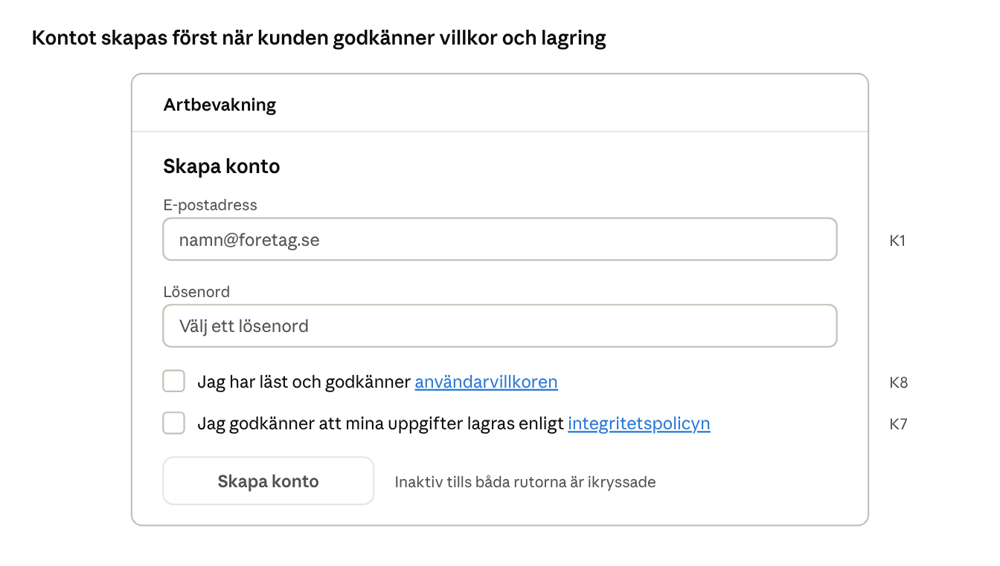
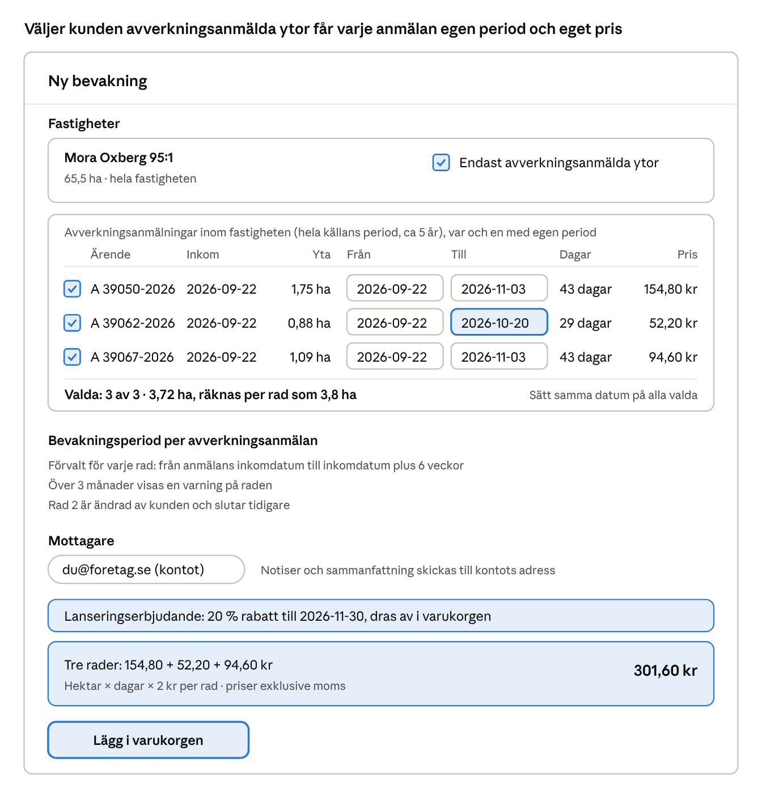
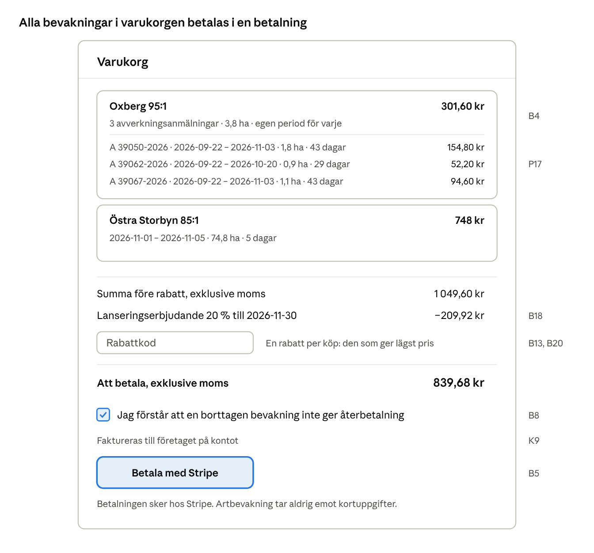
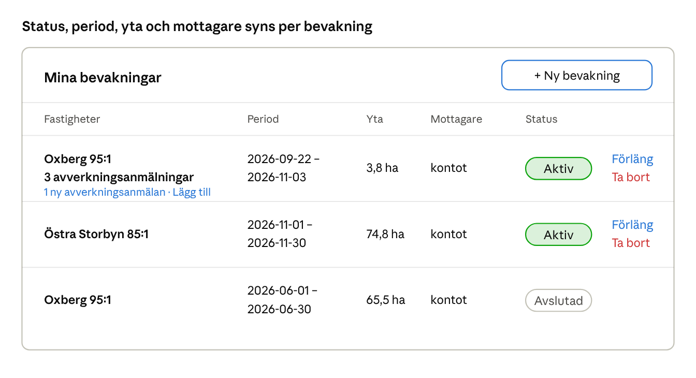
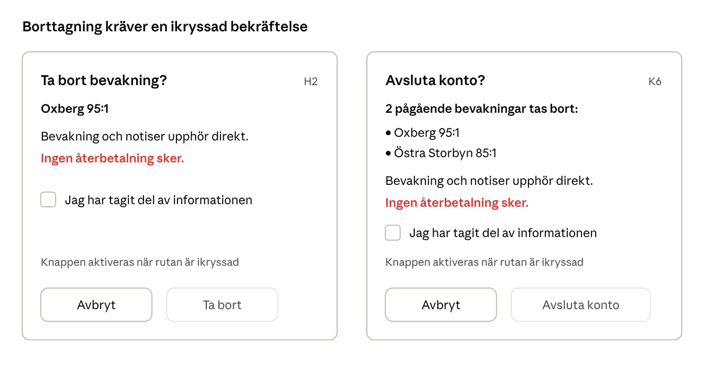
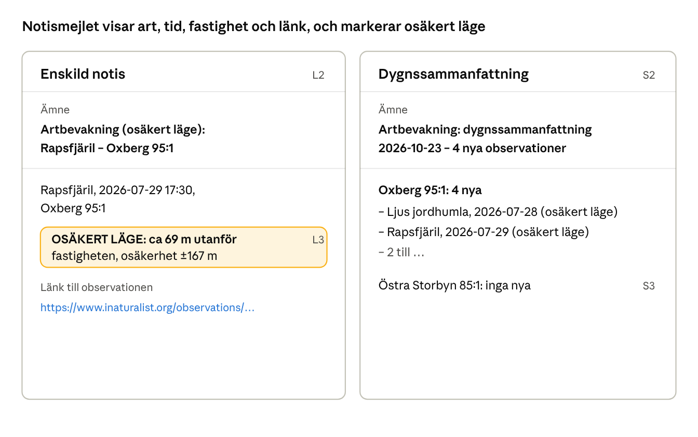
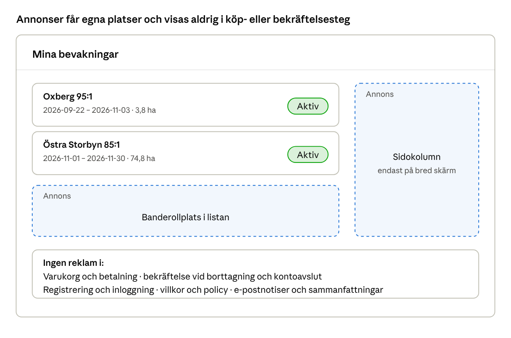
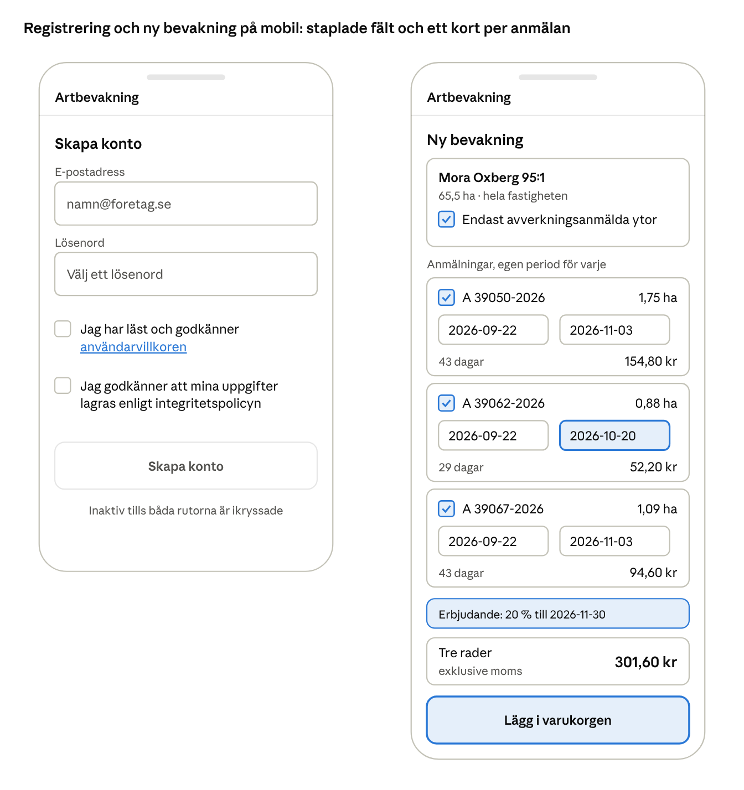
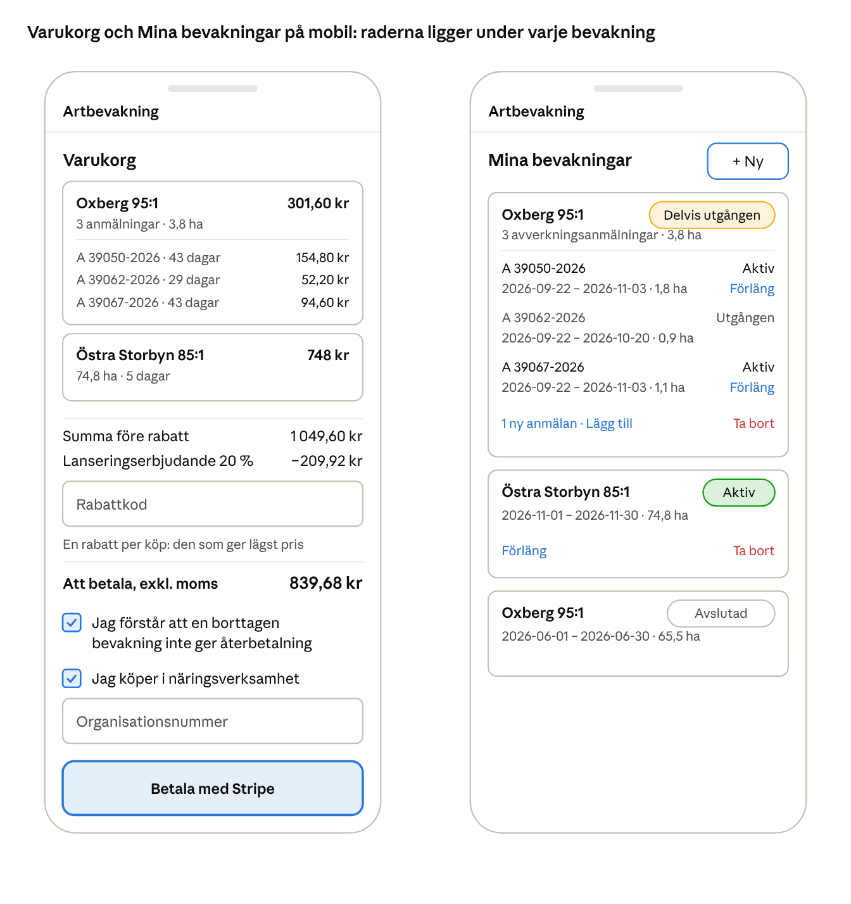

# PRD: Artbevakning – notiser om artobservationer på fastigheter

2026-10-24 · Henrik

## 1. Sammanfattning

Artbevakning blir en betaltjänst där skogsägare och rådgivare får e-postnotiser så snart en ny artobservation görs på en bevakad fastighet, med valfritt begränsning till ytor som har avverkningsanmälan. Prototypen visar att kärnflödet fungerar mot riktiga datakällor; PRD:n beskriver vad som krävs för att göra det till en produkt med konton, betalning och drift i molnet.

- **Konto:** personlig inloggning, godkännande av användarvillkor och lagring av uppgifter vid registrering, och möjlighet att avsluta kontot (då tas även pågående bevakningar bort efter bekräftelse). Ett konto kan ha godtyckligt många bevakningar och fastigheter.
- **Bevakning:** en fastighet, valfritt avgränsad till avverkningsanmälda ytor, med valfri bevakningsperiod; en varning visas om den är längre än 3 månader.
- **Mottagare:** kontots e-postadress, som är den enda mottagaren. Notiser skickas så snart en ny observation upptäcks, med länk till observationen. Daglig sammanfattning är ett val.
- **Betalning:** 2 kr per hektar och dag, betalas i förskott via en varukorg och en betalning (Stripe). Rabattkod kan anges, och en administratör hanterar rabattkoder och grundpris. Borttagning av en bevakning ger ingen återbetalning, och kunden måste bekräfta att hen tagit del av det.
- **Drift:** egen server eller molntjänst, till exempel AWS.

## 2. Bakgrund och prototypens status

Prototypen bevakar redan en riktig fastighet och mejlar notiser, men den är en enanvändarlösning utan inloggning som kör på en enskild dator. Kraven nedan bygger vidare på den.

| Förmåga i prototypen | Status |
| --- | --- |
| Sökning av observationer via Artdatabankens SOS-API (flera källor: Artportalen, iNaturalist m.fl.) | Provkörd live, inklusive sidindelning över 1 000 träffar |
| Fastighetsgeometri via Lantmäteriets fastighetsindelning (beteckning → polygon) | Provkörd live; matchar Forestand-geometrin för Östra Storbyn 85:1 till 100 % |
| Inläsning av Forestand-fil som fastighetsgeometri | Provkörd mot en riktig fil |
| Startdatum bakåt eller framåt i tiden, bakåtblickande notiser vid skapande | Provkörd live (105 fynd sedan 2026-01-01 för Östra Storbyn 85:1) |
| Notis med art, tidpunkt, fastighet och länk till fyndet | Provkörd; länken går till Artportalen eller fyndets egen källa |
| Markering "osäkert läge" för fynd strax utanför gränsen | Provkörd live (Mora Oxberg 95:1: 4 notiser) |
| E-post via SMTP, daglig sammanfattning kl 09:00 (prototypen stöder även flera mottagare, vilket tas bort i produkten) | E-post provskickad live; sammanfattningen verifierad med enhetstester, inte än i drift |
| SMS via 46elks | Byggt men aldrig skickat på riktigt (nycklar saknas) |
| Timvis kontroll som bakgrundstjänst | Kör på en Mac; 22 automatiska tester |

Saknas helt: konton och inloggning, betalning, avverkningsanmälan som kartlager, varning vid lång bevakningsperiod och beloppstak, drift i molnet och en databas för flera kunder (prototypen använder SQLite i en enda process).

## 3. Kunder och användarfall

Primära kunder är skogsägare, skogsförvaltare och naturvårds- eller miljöhandläggare som vill veta direkt när en art observeras på en fastighet, och i synnerhet på ytor där avverkning är anmäld. Detta är en antagen målgrupp; den ska bekräftas med några intervjuer innan lansering.

1. **Skapa konto:** en ny kund registrerar sig med e-post och lösenord, godkänner användarvillkor och lagring av sina uppgifter, och bekräftar adressen.
2. **Bygga en bevakning:** kunden anger en fastighet (beteckning, Forestand-fil eller egen geometri) och väljer om bara avverkningsanmälda ytor ska bevakas, anger bevakningsperiod.
3. **Betala:** kunden ser area och pris per bevakning, lägger flera bevakningar i varukorgen och betalar allt på en gång.
4. **Få notiser:** vid ny observation skickas ett mejl med art, tidpunkt, fastighet och länk till observationen. Valfritt: en daglig sammanfattning.
5. **Följa upp:** kunden ser sina bevakningar och skickade notiser. Nya avverkningsanmälningar visas tydligt, och bevakningen kan kompletteras med dem eller förlängas, med en varning om den totala perioden blir längre än 3 månader.
6. **Avsluta:** kunden tar bort en bevakning efter att ha bekräftat att ingen återbetalning sker.

## 4. Omfattning

Första versionen omfattar allt i avsnitt 5 och 6, drift enligt avsnitt 8 och datakällorna i avsnitt 7. Följande ingår inte (förslag att bekräfta):

- **SMS-notiser.** Prototypen stöder det, men kraven ger varken pris eller kostnadstäckning för det; beslutat att utelämna i version 1.
- **Skyddade och sekretessbelagda artfynd.** Fynd som Artdatabanken har dolt eller generaliserat kräver behörighet hos Artdatabanken och ger inget eller bara osäkert notis. Arter med skyddsnivå kan ge notis när det enskilda fyndet är öppet.
- **Återbetalning.**
- **Mobilapp, webbapp med karta och push-notiser (se avsnitt 15 om framtida utökningar).**

## 5. Funktionella krav

Kraven är numrerade så att de kan refereras i test och uppföljning. "Ska" är krav från beställaren; krav markerade (förslag) är mina antaganden som behöver bekräftas.

### 5.1 Konto och inloggning

| ID | Krav |
| --- | --- |
| K1 | En kund ska kunna skapa ett personligt konto med e-postadress och lösenord. |
| K2 | E-postadressen ska verifieras med länk innan bevakningar kan betalas (förslag). |
| K3 | Kunden ska kunna logga in, logga ut och återställa lösenord via e-post. Version 1 har e-post och lösenord; valfri tvåfaktor för kunder och BankID är möjliga senare utökningar (avsnitt 15). |
| K4 | Lösenord lagras hashade med modern algoritm (t.ex. Argon2 eller bcrypt); inloggningsförsök begränsas mot gissning. |
| K5 | En kund ser bara sina egna bevakningar, fastigheter och notiser. |
| K6 | Kunden ska kunna avsluta sitt konto. Alla pågående bevakningar tas då också bort och bevakningen upphör direkt. kunden måste först bekräfta, efter att ha informerats om att ingen återbetalning sker och vilka bevakningar som tas bort (som H2). Personuppgifter raderas enligt avsnitt 9, utom det som måste sparas för bokföring. |
| K7 | Vid registrering ska kunden aktivt godkänna att hens uppgifter lagras och behandlas (GDPR), efter att ha läst integritetspolicyn. Utan godkännande skapas inget konto. Rutans text innehåller en länk till integritetspolicyn. Godkännande, policyns version och tidpunkt loggas. Den rättsliga grunden fastställs i avsnitt 9. |
| K8 | Vid registrering ska kunden aktivt godkänna användarvillkor som bland annat anger att ingen återbetalning sker, ansvarsbegränsning och datakällornas begränsningar. Rutans text innehåller en länk till användarvillkoren, som kan läsas innan godkännandet. Godkännande, villkorens version och tidpunkt loggas. Vid väsentligt ändrade villkor ska kunden godkänna de nya vid nästa inloggning. Utkast till villkoren och till integritetspolicyn finns i avsnitt 14. |

### 5.2 Bevakningar och fastigheter

| ID | Krav |
| --- | --- |
| P1 | En kund ska kunna skapa godtyckligt många bevakningar, och varje bevakning gäller en fastighet. Flera fastigheter bevakas med flera bevakningar i samma varukorg. |
| P2 | En fastighet anges med fastighetsbeteckning (uppslag mot Lantmäteriet), uppladdad Forestand-fil eller GeoJSON. Systemet visar den uppslagna ytan på karta så att kunden kan kontrollera den (förslag). |
| P3 | För varje fastighet ska kunden kunna välja "endast ytor med avverkningsanmälan". Bevakad yta är då skärningen mellan fastigheten och kartlagret med avverkningsanmälningar; annars hela fastigheten. Kunden väljer vilka avverkningsanmälningar som ska bevakas och anger en egen period för varje (P13, P14). Varje vald avverkningsanmälan är en rad i bevakningen med egen yta, period och eget pris (P17). |
| P4 | Bevakningsperioden anges med start- och slutdatum, för hela fastigheten en gång per bevakning och vid avverkningsval separat för varje vald avverkningsanmälan (P13, P14). Perioden har ingen fast längdgräns, men en varning visas om den är längre än 3 månader (per rad vid avverkningsval), även när startdatum ligger bakåt i tiden. Beloppstaket per köp (B11) är den hårda gränsen. Startdatum får ligga bakåt eller framåt i tiden. |
| P5 | Ligger startdatum bakåt i tiden ska notiser genereras direkt för observationer från startdatum till nu (beteende från prototypen). Vid avverkningsval gäller det varje rad för sig: fynd inom radens yta och period. |
| P6 | Flertydiga eller okända beteckningar ger ett begripligt fel med förslag, t.ex. att ange kommun (beteende från prototypen). |
| P7 | Kunden ska se bevakad area i hektar och priset innan betalning, vid avverkningsval per rad och totalt. |
| P8 | Vid valet "endast avverkningsanmälda ytor" fryses bevakad yta och varje rads period vid köp. Priset räknas på arean vid köp och ändras inte under perioden. |
| P9 | När en ny avverkningsanmälan tillkommer inom en fastighet i en aktiv bevakning skickas information om det på samma sätt som en notis (tidigast dagen efter, eftersom källan uppdateras varje natt), med fastighet, tidpunkt, yta i hektar och länk till bevakningen. |
| P10 | När kunden loggar in och tittar på sina bevakningar ska det tydligt framgå vilka som har nya avverkningsanmälningar. |
| P11 | Kunden ska enkelt kunna komplettera en bevakning med de nya ytorna. Kompletteringen läggs i varukorgen och betalas som övriga bevakningar. Vid avverkningsval blir varje ny avverkningsanmälan en ny rad med egen period (förvald enligt P14), priset är radens hektar × dagar × grundpriset och övriga rader är oförändrade; för hela fastigheten är priset nya hektar × återstående dagar × grundpriset och slutdatum oförändrat. |
| P12 | Har en fastighet 0 ha avverkningsanmälda ytor vid köp blockeras köpet med en förklaring, och kunden kan i stället välja hela fastigheten. |
| P13 | Väljer kunden "endast avverkningsanmälda ytor" ska en lista visas över fastighetens avverkningsanmälningar för hela källans period (ca 5 år), med ärendenummer, inkomdatum, avverkningstyp och yta inom fastigheten. Kunden kryssar i de avverkningsanmälningar som ska bevakas och anger start- och slutdatum för varje (förvalda enligt P14); ett kommando sätter samma datum på alla valda rader. Bevakad yta, pris och köpsspärren vid 0 ha (P12) räknas bara på de valda avverkningsanmälningarna. |
| P14 | När avverkningsanmälningar har valts är förvalt startdatum för varje rad dess inkomdatum och förvalt slutdatum dess inkomdatum plus 6 veckor. Blir en rads period längre än 3 månader visas en varning, men datumen klipps inte. Kunden kan ändra datumen för varje rad, och beloppstaket per köp (B11) är den hårda gränsen. |
| P15 | De valda avverkningsanmälningarna sparas på bevakningen som rader med egen period, och ytan och perioderna fryses vid köp (P8). Avverkningsanmälningar som kommer efter köpet visas som nya i listan och kan läggas till som komplettering (P9–P11). |
| P16 | Fastighetens geometri och de valda avverkningsanmälningarnas ytor sparas som en ögonblicksbild vid köp och används under hela bevakningen, även om Lantmäteriets eller Skogsstyrelsens data ändras senare. |
| P17 | Vid avverkningsval har varje vald avverkningsanmälan egen period, egen yta och eget pris (en rad). Ett fynd ger notis för en rad bara om det ligger inom radens yta och period, och notisen anger ärendenummer. Bevakningen är en kundens enhet för köp, varukorg och borttagning; raderna har egen status och egen förlängning. |
| P18 | Valda avverkningsanmälningar prissätts var och en för sig, även när deras ytor och perioder överlappar; ingen sammanslagning av ytor görs. Fakturan visar därför en rad per anmälan. |

### 5.3 Mottagare

| ID | Krav |
| --- | --- |
| M1 | Kontots e-postadress är den enda mottagaren av notiser och sammanfattning. Det går inte att lägga till andra mottagare. |
| M2 | Kontots adress verifieras innan notiser skickas (K2). Kunden kan byta adress på kontot, och bytet verifieras med en länk till den nya adressen (förslag). |

### 5.4 Notiser

| ID | Krav |
| --- | --- |
| L1 | En notis skickas så snart en ny observation upptäcks inom bevakad yta och bevakningsperiod (vid avverkningsval radens yta och period). Målet för "så snart" definieras i avsnitt 10, och vilka observationer som ger notis står i avsnitt 5.8. |
| L2 | Notisen innehåller typ av observation (art), tidpunkt, fastighet, vid avverkningsval avverkningsanmälans ärendenummer, och en klickbar länk till observationen hos Artdatabanken eller fyndets egen källa. Varje observation anger källans namn (till exempel Artportalen eller iNaturalist). Samma fynd i flera källor avdupliceras inte i version 1. |
| L3 | Fynd utanför gränsen men inom positionens osäkerhet (högst 500 m) ger notis och markeras "OSÄKERT LÄGE" med avstånd och osäkerhet (beteende från prototypen). |
| L4 | En observation ger notis högst en gång per bevakning. Misslyckade utskick försöks igen utan att skapa dubbletter (förbättring av prototypen). |
| L5 | Den första genomgången vid köp skickas som ett enda startrapport-mejl med alla träffar sedan bevakningsperiodens start (vid avverkningsval varje rads start), som en lista. |
| L6 | Notiser baseras bara på observationer vars licens tillåter kommersiell användning. Ett licensfilter styrs av administratören, och observationens licens hämtas från SOS (fältet license). Förvalt läge (förslag) är försiktigt: notiser för Artportalens fynd och för observationer med licensen cc0, cc-by eller cc-by-sa. Observationer med icke-kommersiell licens (cc-by-nc, cc-by-nc-sa), licens med förbud mot bearbetning, utan angiven licens (utom Artportalens) eller från källor utan känd åtkomstträtt utesluts. I stickprovet kring Uppsala ger det notiser för ca 83 % av observationerna (11 790 av 14 230). Läget kan lindras när juristen svarat (avsnitt 9). |
| L7 | Varje kontroll som hittar nya observationer skickar ett enda mejl per bevakning med alla nya observationer i en lista (art, tid, länk, ärendenummer vid avverkningsval, markering för osäkert läge), sorterad efter observationernas klockslag. En inventering som pagår längre än tiden mellan kontrollerna kan därför ge flera mejl, ett för varje kontroll där nya observationer har tillkommit. |
| L8 | Tjänsten gör en kontroll var 15:e minut. Löftet till kunden är en notis inom 30 minuter från att observationen syns i SOS (95 % av notiserna). SOS visade i en mätning 2026-10-27 nya observationer ca 10 minuter efter rapport. Avverkningsfilen hämtas nattligen. |
| L9 | Ett mejl visar högst de 50 senaste observationerna och antalet övriga. Alla träffar ligger som CSV-bilaga. Det gäller både startrapport och vanliga notiser vid stor inventering. |

### 5.5 Daglig sammanfattning

| ID | Krav |
| --- | --- |
| S1 | Kunden ska kunna välja om en daglig sammanfattning ska skickas. Valet gäller kontot, och sammanfattningen listar alla kontots aktiva bevakningar. |
| S2 | Sammanfattningen skickas varje dygn kl 09:00 svensk tid, även om inget registrerats. |
| S3 | Kontot får högst en sammanfattning per dygn, även om det har flera aktiva bevakningar. |
| S4 | Sammanfattningen listar notiserna sedan förra sammanfattningen per fastighet (vid avverkningsval med ärendenummer), inklusive länkar. |

### 5.6 Hantering av bevakning

| ID | Krav |
| --- | --- |
| H1 | Kunden ska kunna ta bort en bevakning. Bevakning och notiser upphör direkt. Vid avverkningsval tas hela bevakningen bort, inte enskilda rader (version 1). |
| H2 | Innan borttagning visas att ingen återbetalning sker. Kunden måste aktivt bekräfta att hen tagit del av det (kryssruta), och bekräftelsen loggas med tidpunkt. |
| H3 | En bevakning är aktiv först när betalningen är genomförd; utgångna bevakningar bevakas inte längre och kan inte förlängas efter slutdatum (en ny bevakning skapas i stället). Vid avverkningsval gäller det varje rad: bevakningen är delvis utgången när några rader gått ut och utgången först när alla gjort det. |
| H4 | Kunden ska kunna förlänga slutdatum för en aktiv bevakning, vid avverkningsval för en eller flera aktiva rader. Blir den totala perioden (från startdatum till nytt slutdatum, per rad vid avverkningsval) längre än 3 månader visas en varning. Beloppstaket per köp (B11) begränsar förlängningen. |
| H5 | Förlängningen läggs i varukorgen och betalas som övriga bevakningar. Priset är bevakad yta × tillkommande dagar × grundpris (per förlängd rad vid avverkningsval), och rabattkod kan användas. Bevakningen ändras först när betalningen bekräftats; en obetald förlängning ändrar ingenting. |
| H6 | Förlängningen gäller bevakningens fastighet och yta som den var vid köp, inklusive eventuella kompletteringar (P11). Nya avverkningsanmälningar kommer inte med automatiskt (förslag). |
| H7 | Aktiva bevakningar kan tas bort; utgångna kan inte tas bort. Utgångna bevakningar syns i 12 månader och döljs därefter. Notishistoriken sparas lika länge som bevakningen syns och raderas därefter. Köp- och kvittouppgifter sparas enligt bokföringskravet. |

### 5.7 Administration och rabattkoder

En administratör hanterar rabattkoder och grundpris; kundens sida av rabattkoder finns i B13–B15 i avsnitt 6. Punkter markerade (förslag) är mina antaganden.

| ID | Krav |
| --- | --- |
| A1 | Det ska finnas en administratörsroll med egen inloggning, åtskild från vanliga kunder. Inloggning kräver tvåfaktor, och administratörer skapas manuellt av driftansvarig, inte via gränssnittet. Alla administratörsåtgärder loggas med vem, vad och när (förslag). |
| A2 | En administratör ska kunna lägga till en rabattkod (kod och rabatt i procent) och ta bort en rabattkod. En borttagen kod kan inte användas i nya köp; tidigare köp påverkas inte. |
| A3 | Koden ska vara unik och skiftlägesokänslig, och rabatten ska ligga mellan 1 och 100 procent (förslag). |
| A4 | En administratör ska kunna ändra grundpriset i kronor per hektar och dag (initialt 2 kr). Ändringen gäller nya köp; redan köpta bevakningar behåller sitt pris (B1). |
| A5 | Administratören ser en lista över alla rabattkoder med rabatt, nuvarande grundpris och historik över prisändringar (förslag). |
| A6 | Vanliga kunder ska inte kunna nå administrationen, varken via gränssnittet eller API:t. |
| A7 | Administratörer har skrivskyddad insäkt i en kunds bevakningar och notiser, bara i samband med ett supportärende, och varje uppslag loggas (vem, vad, när). De kan inte ändra kundens bevakningar eller se lösenord. Integritetspolicyn anger insäkten. |
| A8 | En administratör ska kunna skapa, ändra och avsluta ett erbjudande (namn, procent, start och slut). Ett pågående erbjudande kan avslutas i förtid men inte ändras bakåt, och redan gjorda köp påverkas inte. Före aktivering visas en bekräftelse med procent och tid, och ändringen loggas (A1). |
| A9 | En administratör ska kunna slå på och av förstagångsrabatten och ändra procenten. Ändringen gäller nya köp och loggas. |
| A10 | Administratören ser en lista över erbjudanden (kommande, pågående och avslutade) och förstagångsrabattens nuvarande läge, med historik (vem, vad, när) och antal köp som fick varje rabatt (förslag). |

### 5.8 Vilka observationer man får notiser om

Notiser skickas för publika artobservationer i Artdatabankens SOS som ligger inom bevakad yta och bevakningsperiod, enligt reglerna nedan. Reglerna är utgångsläget; undantag läggs till här senare.

| ID | Regel |
| --- | --- |
| O1 | Observationens datum (när fyndet gjordes) ligger inom bevakningsperioden. Observationer från tiden före köpet ger notis direkt (P5). |
| O2 | Observationens position ligger inom bevakad yta, eller strax utanför så att positionens osäkerhet gör att den kan ligga innanför (högst 500 m osäkerhet). Det senare ger notis med markeringen "osäkert läge" (L3). |
| O3 | Alla arter och artgrupper ingår: växter, djur, svampar, lavar och mossor, både vanliga och sällsynta. Det finns inget artfilter i version 1. |
| O4 | Alla källor i SOS ingår, med förbehåll för licensfiltret (L6). Alla verifieringsstatusar ingår, både verifierade och ej verifierade fynd. |
| O5 | Skyddade och sekretessbelagda fynd som Artdatabanken har dolt eller generaliserat ger inget eller bara osäkert notis, eftersom det öppna API:et inte lämnar ut dem med full position. Arter med skyddsnivå ger notis när det enskilda fyndet är öppet. |
| O6 | En observation ger notis högst en gång per bevakning (L4). Ändras eller tas en observation bort hos källan efter notisen skickas ingen ny notis. |
| O7 | Observationer som saknar koordinater men ändå träffas av SOS urval ger notis utan markering (prototypens beteende). |
| O8 | Kontrollen fortsätter 14 dagar efter slutdatum för observationer som är daterade inom perioden men rapporteras senare. Observationer daterade före startdatum ger aldrig notis, även om de rapporteras senare. De 14 dagarna påverkar inte priset. |
| O9 | Vid valet endast avverkningsanmälda ytor gäller exakt de valda ytorna plus positionens osäkerhet. Ingen buffert runt ytorna i version 1. |

**Undantag.** Inga undantag gäller i version 1. Möjliga undantag att överväga senare, och som i så fall läggs till i tabellen ovan:

- bara rödlistade arter eller signalarter
- utesluta mycket vanliga arter
- bara verifierade fynd
- bara vissa källor, till exempel Artportalen
- arter som kunden själv väljer bort, en buffert runt avverkningsanmälans yta, och avduplicering av samma fynd i flera källor

## 6. Betalning och prissättning

Kunden betalar 2 kr per hektar och dag för bevakad yta, i förskott, och priset ska vara en konfigurerbar parameter eftersom det är ett startvärde.

```latex
\text{pris} = \text{hektar} \times \text{dagar} \times 2\ \text{kr}
```

| ID | Krav |
| --- | --- |
| B1 | Priset är 2 kr per hektar och dag initialt och ändras utan kodrelease. Priset som gällde vid köp sparas på bevakningen. Grundpriset ändras av en administratör (A4). |
| B2 | Bevakad areal är hela fastighetens yta, eller bara ytor med avverkningsanmälan om kunden valt det (P3); vid avverkningsval räknas den per avverkningsanmälan. |
| B3 | Kunden betalar i förskott för hela bevakningsperioden när bevakningen läggs upp. |
| B4 | Kunden ska kunna lägga flera bevakningar i en varukorg och betala allt på en gång, med en enda betalning. |
| B5 | Betalning görs med en extern betalningslösning, t.ex. Stripe Checkout. Kortuppgifter hanteras aldrig av Artbevakning. Version 1 stöder kortbetalning; Swish och faktura kan komma senare. |
| B6 | En bevakning aktiveras först när betalningen bekräftats av betalningsleverantörens webhook. Webhooks hanteras idempotent så att samma betalning inte aktiverar två gånger. |
| B7 | Kunden får en betald faktura (via Stripe Invoicing) med specifikation per bevakning (fastighet, hektar, dagar, belopp, moms) och vid avverkningsval per avverkningsanmälan (ärendenummer, hektar, period, dagar, belopp), som mejlas. Moms beräknas med Stripe Tax: 25 %, och omvänd skattskyldighet för EU-företag med giltigt momsnummer. Kunden anger organisationsnummer (B10) och fakturaadress i kassan. |
| B8 | En borttagen bevakning ger ingen återbetalning. Kunden informeras vid köp och vid borttagning och måste bekräfta (H2). |
| B9 | Dagar räknas från och med startdatum till och med slutdatum och inkluderar dagar före köpdatum. Vid avverkningsval räknas dagarna per rad. Perioden har ingen fast längdgräns; en varning visas över 3 månader (P4). |
| B10 | Tjänsten säljs till företag och yrkesutförare. Priser visas exklusive moms och moms läggs på vid betalning. Köparen intygar vid köp med en ikryssad ruta att det sker i näringsverksamhet och anger organisationsnummer (obligatoriskt). Numret formatkontrolleras men kontrolleras inte mot register i version 1. Intyg, organisationsnummer och tidpunkt sparas och skrivs på kvittot. |
| B11 | Ett konfigurerbart tak per köp (belopp eller hektar) gäller. Över taket visas "kontakta oss" i stället för betalning. Taket är initialt 5 000 kr per köp, ändras av en administratör (förslag) och är den hårda gränsen; det finns ingen separat gräns för periodens längd. Taket gäller varukorgens fullpris före rabatt, och komplettering och förlängning räknas som övriga rader i samma varukorg. |
| B12 | Support sker via e-post till support@mjukvaruverkstan.se, som visas i gränssnittet och i mejlen. Adressen finns inte ännu och måste skapas före lansering. Svar ges inom 3 arbetsdagar och svarstiden anges för kunden. Återbetalning görs bara manuellt, via Stripe, när fel uppstått hos Artbevakning. |
| B13 | Kunden ska kunna ange en rabattkod i varukorgen. En giltig kod ger en procentuell rabatt på varukorgens belopp före moms, som visas på en egen rad med nytt totalbelopp. En ogiltig eller borttagen kod ger ett tydligt felmeddelande. |
| B14 | Rabatten gäller alla bevakningar i varukorgen. Koden och rabatten sparas på ordern och visas på kvittot (beslutat: flergångskod utan giltighetstid, en kod per köp, ingen kombination av koder). |
| B15 | Blir totalen 0 kr (rabatt 100 %) aktiveras bevakningarna utan betalning hos Stripe (förslag). |
| B16 | Ytan avrundas uppåt per bevakning, vid avverkningsval per rad, till närmaste 0,1 ha (aldrig nedåt) och priset räknas exakt i öre. Minsta belopp per köp är 200 kr, räknat på varukorgens fullpris före rabatt och exklusive moms; är fullpriset lägre debiteras 200 kr. |
| B17 | Priset låses när kunden går till kassan. Varukorgen sparas 7 dagar; öppnas kassan igen räknas priset om. En betalning gäller hela varukorgen: antingen aktiveras alla bevakningar eller ingen. En misslyckad betalning lämnar varukorgen kvar. |
| B18 | Ett tidsbegränsat erbjudande är en procentuell rabatt som gäller alla kunder automatiskt, utan kod, på hela varukorgen (alla rader, även kompletteringar och förlängningar). Det har namn, rabatt i procent (1–99), startdatum och slutdatum med klockslag i svensk tid. Vilket erbjudande som gäller avgörs när priset låses vid kassan (B17); en betalning som slutförs efter erbjudandets slut behåller rabatten om kassan öppnades under erbjudandet (kassans giltighet högst 24 timmar, förslag). Högst ett erbjudande får vara aktivt åt gången. |
| B19 | Förstagångsrabatten är en procentuell rabatt (1–99) på ett organisationsnummers första genomförda köp. Den ges automatiskt i kassan och kan slås på och av, och procenten kan ändras, av en administratör. Ett köp räknas som första när betalningen genomförts; ett köp på 0 kr räknas inte. Rabatten följer organisationsnumret (B10) så att den inte tas flera gånger genom att skapa nya konton; eftersom numret bara formatkontrolleras i version 1 är skyddet begränsat. |
| B20 | Ett köp får en enda rabatt: den som ger lägst pris av erbjudandet, förstagångsrabatten och rabattkoden. Rabatter kombineras inte (jfr B14). Anger kunden en rabattkod som ger mindre rabatt än den som redan gäller visas ett meddelande och den bättre rabatten behålls. |
| B21 | Gällande erbjudande (namn, procent och slutdatum) visas på sidan Ny bevakning och i varukorgen, och den rabatt som används visas på en egen rad med belopp före moms och nytt totalbelopp. Rabattens namn och procent sparas på köpet och skrivs på fakturan och kvittot (B7, B14). Rabatten räknas på varukorgens belopp före moms; beloppstaket (B11) och minsta beloppet (B16) räknas på fullpriset före rabatt. |

**Räkneexempel (förslag på beräkning, belopp utan moms):**

| Bevakad areal | Bevakningsperiod | Pris |
| --- | --- | --- |
| 10 ha | 30 dagar | 600 kr |
| 50 ha | 30 dagar | 3 000 kr |
| 74,8 ha (Östra Storbyn 85:1, hela fastigheten) | 30 dagar | 4 488 kr |

Antaganden i exemplen (dagar bakåt och moms är beslutade i avsnitt 12): dagar räknas från och med startdatum till och med slutdatum och inkluderar därför dagar bakåt i tiden, arealen avrundas upp per bevakning till närmaste 0,1 ha (B16), och 2 kr är exklusive moms.

## 7. Datakällor och integrationer

Tjänsten bygger på fem externa tjänster; två av dem (SOS och Lantmäteriet) och e-post är provade i prototypen, medan avverkningsanmälan är hittad men ännu inte provad, och betalning är ny och ännu inte påbörjad.

| Källa | Används till | Status | Att utreda för produktion |
| --- | --- | --- | --- |
| Artdatabankens SOS-API (Species Observation System) | Observationer från Artportalen, iNaturalist m.fl.; filter på yta och datum | Provad live med prenumerationsnyckel | Användarvillkor för kommersiell vidareanvändning, API-kvot, antal anrop per fastighet och timme, licenser per datakälla och per observation (se L6). Hur många fynd Artdatabanken döljer eller generaliserar: ett urval för Dalarna (apr–okt 2026) gav 25 fynd av arter med skyddsnivå 3–5 bland 1 000, alla öppna; jämför antal och position mot Artportalens webbplats för samma yta och period |
| Lantmäteriets fastighetsindelning (OGC API Features) | Fastighetsbeteckning → geometri | Provad live med Basic-inloggning | Avtal/licens för kommersiell tjänst och för hur många anrop som tillåts |
| Kartlager för avverkningsanmälningar | Avgränsa bevakning till avverkningsanmälda ytor (P3) | **Provad (fil)** | Skogsstyrelsens nedladdningstjänst: rikstäckande GeoPackage (ca 69 MB, SWEREF 99 TM) med 129 997 ytor; ingen WFS hittad. Filen är provad, se resultatet nedan. Licens: CC0 1.0, öppna data enligt Skogsstyrelsens villkorssida (uppdaterad 2026-05-13); källhänvisning önskas men krävs inte. Filen uppdateras varje natt (uppgift från beställaren), så nya ytor upptäcks tidigast nästa dygn |
| Stripe (eller likvärdig) | Betalning, kvitto | Ej påbörjad | Betalsätt som stöds för SEK, moms, webhooks, utbetalning till svenskt bankkonto |
| E-postutskick | Notiser, sammanfattning, verifiering, återställning | Prototypen använder SMTP hos one.com | Byt till en leverantör för transaktionsmejl (t.ex. Amazon SES) med SPF/DKIM/DMARC för avsändardomänen |

**Avverkningsanmälan som bevakningsyta.** När kunden väljer endast avverkningsanmälda ytor beräknas bevakad yta som skärningen mellan fastigheten och avverkningsanmälningarnas ytor. Systemet ska uppdatera lagret regelbundet och hantera att nya avverkningsanmälningar tillkommer under bevakningsperioden; ytan fryses vid köp, och nya ytor meddelas och kan läggas till (P8–P11). Eftersom källan är en rikstäckande fil på ca 69 MB hämtas den regelbundet och läggs i en rumslig databas i stället för att frågas live.

**Resultat av provet med filen (hämtad 2026-10-24).**

- **Innehåll:** 129 997 polygoner med inkomdatum från 2021-10-24 till 2026-10-23 (ca 5 år), ca 190 nya ytor per vardag. Alla har status "Anmält för avverkning".
- **Nyckel:** OBJECTID är unikt per yta. Ärendenumret (t.ex. A 44298-2026) är inte unikt, eftersom ett ärende kan ha flera ytor (129 869 olika ärendenummer).
- **Attribut:** län, kommun, avverkningstyp, anmäld areal i hektar, inkomdatum med klockslag och en klass. Klassen "NyAvverkningsanmalan" gäller ytor som kommit in sedan 2026-09-12 (6 514 st), resten har klassen "Avverkningsamalan".
- **Ny avverkningsanmälan:** kan upptäckas genom att jämföra OBJECTID mellan två hämtningar. Filen har rumsligt index och går att skära mot fastigheter.
- **Prov på riktiga fastigheter:** Östra Storbyn 85:1 har 12,6 ha avverkningsanmäld yta av 74,8 ha (ärende A 23586-2023 och A 9412-2026). Mora Oxberg 95:1 har 3,7 ha av 65,5 ha (A 39050, A 39062 och A 39067-2026, alla inkomna 2026-09-22).
- **Uppdatering:** flödets tidsstämpel är 2026-10-23 kl 21:53 och den senaste ytan kom in kl 21:29, vilket tyder på att filen byggs om efter kvällen. Det är inte bekräftat; det kräver hämtningar över flera dygn.

## 8. Icke-funktionella krav och driftsättning

Tjänsten ska drivas på egen server eller i en molntjänst, till exempel AWS, och måste klara att flera kunder delar samma installation, vilket prototypen inte gör.

| ID | Område | Krav |
| --- | --- | --- |
| D1 | Drift | Körs i en molntjänst eller på egen server; beslutat: AWS i eu-north-1 (Stockholm) med containrar på ECS Fargate, PostgreSQL med PostGIS på RDS, hemligheter i Secrets Manager och e-post via SES. |
| D2 | Databas | SQLite byts mot PostgreSQL med PostGIS. Geometrier (fastigheter, avverkningsanmälningar och ögonblicksbilder) ligger i databasen med rumsligt index, och skärningar och områdessökningar görs där. Dubblettskydd och "skickad"-status ligger i databasen så att fler instanser inte skickar samma notis två gånger. |
| D3 | Bakgrundsjobb | Bevakning, sammanfattning och betalningshändelser körs i en separat arbetsprocess (worker), inte i webbprocessen. Endast en worker är aktiv per jobb (lås). |
| D4 | Tillgänglighet | Tjänsten ska startas om automatiskt vid fel, och missade kontroller ska hämtas ikapp utan att notiser går förlorade eller dubbleras. |
| D5 | Säkerhet | All trafik över HTTPS. Inga nycklar i koden eller i git. Roller med minsta möjliga rättigheter. Beroenden uppdateras och skannas. |
| D6 | Säkerhetskopiering | Daglig backup av databasen med återställningstest. Mål för återställning anges i avsnitt 10. |
| D7 | Övervakning | Loggning och varningar (ej till kunder) vid misslyckade utskick, misslyckade API-anrop mot Artdatabanken/Lantmäteriet/Stripe och försenad bevakning. |
| D8 | Skalbarhet | Antalet API-anrop mot SOS måste hållas inom kvoten. SOS tillåter högst 10 000 träffar per sökning (skip plus take), så större hämtningar delas upp i tidsfönster. Prototypen gör minst ett anrop per del av fastighetens geometri och per kontroll; med många bevakningar behövs gruppering eller cache (se risker). |
| D9 | E-postleverans | Avsändardomän med SPF, DKIM och DMARC; studs och klagomål hanteras. |
| D10 | Språk | Gränssnitt och mejl på svenska i första versionen. |
| D11 | Drift | Missade kontroller tas ikapp vid nästa lyckade kontroll. Vid avbrott i en källa över 24 timmar skickas ett mejl till berörda kunder om försenade notiser; ingen ersättning utgår. Uteblivet svar från betalningsleverantören efter betalning stäms av automatiskt, och supporten kan aktivera manuellt. |
| D12 | Lokal körning | Hela tjänsten ska gå att köra på en utvecklingsdator med ett enda kommando (Docker Compose): webb, arbetsprocess, PostgreSQL med PostGIS och en lokal mejlfångare (till exempel Mailpit) som visar utgående mejl i stället för att skicka dem. Samma containerbilder och samma konfiguration via miljövariabler används lokalt och på AWS. |
| D13 | Betalning | Betalning går genom en adapter med två lägen: simulerad betalning och Stripe. Den simulerade har en egen kassasida med knapparna "Betala" och "Misslyckad betalning" och skickar samma webhook-händelser som Stripe, så att aktivering (B6), faktura (B7), rabattkod (B13–B15), tak (B11), minsta belopp (B16) och varukorg (B17) prövas genom samma flöde. Den simulerade betalningen flyttar aldrig pengar och kontaktar inte Stripe. |
| D14 | Betalning | Innan driftsatt på AWS används Stripe i testläge med testnycklar och Stripes testkort, och Stripes kommandoradsverktyg vidarebefordrar webhooks till den lokala tjänsten. Skiftet mellan simulerad betalning, testläge och skarpt läge sker bara via konfiguration. |
| D15 | Säkerhet | Simulerad betalning och mejlfångaren kan inte slås på i produktionsläge: tjänsten vägrar starta om skarpa Stripe-nycklar och simulerad betalning är påslagna samtidigt, och ett tydligt märke visas på alla sidor när betalningen är simulerad. |
| D16 | Lokal provning | Lokalt kan tjänstens klocka ställas fram, så att kontrollen var 15:e minut, sammanfattningen kl 09:00, periodens slut, de 14 dagarna efter slutdatum och varukorgens 7 dagar går att pröva utan att vänta. Mot Artdatabanken, Lantmäteriet och Skogsstyrelsen används de riktiga tjänsterna med nycklar i en lokal .env-fil som inte checkas in; för tester finns inspelade svar så att de går utan nät och nycklar. Lokal seed-data har två exempelfastigheter (Mora Oxberg 95:1 och Östra Storbyn 85:1), ett testkonto och en testadministratör med fast tvåfaktorkod som bara gäller lokalt. |
| D17 | Gränssnitt | Webbgränssnittet ska fungera på mobil, iPad och dator i vanliga webbläsare, från en skärmbredd på ca 375 px: responsiv layout, tabeller och datumfält per rad som staplas på smal skärm, och tryckytor som går att träffa med fingret (minst 44 px, förslag). Kassan (Stripe Checkout) och mejlens länkar ska fungera i mobilens webbläsare. Samma funktioner finns på alla enheter. |

## 9. Juridik, integritet och villkor

Innan tjänsten tas betalt för behöver följande kläras av jurist; punkterna nedan är en checklista, inte rådgivning.

| Ämne | Vad som gäller eller behöver avgöras |
| --- | --- |
| Personuppgifter (GDPR) | Tjänsten lagrar kundens e-postadress och kan lagra telefonnummer, plus uppgifter om vilka fastigheter en person bevakar. Behöver integritetspolicy, laglig grund, personuppgiftsbiträdesavtal med molnleverantör, Stripe och e-postleverantör, samt rutin för radering och utdrag. Aktivt godkännande vid registrering (K7) är ett krav från beställaren; om det juridiskt ska vara samtycke eller information, och vilken rättslig grund som gäller, avgörs av juristen. |
| Mottagare | Endast kontoinnehavarens egen e-postadress får notiser. Det undviker att Artbevakning hanterar uppgifter om tredje part och därmed blir personuppgiftsbiträde åt kunden för andra mottagares adresser (juristen bekräftar). |
| Villkor och återbetalning | Ingen återbetalning när en bevakning tas bort. Kunden informeras vid köp och vid borttagning och bekräftar (H2, B8). Om konsumenter ska kunna köpa måste ångerrätt vid distansköp och samtycke till direkt påbörjad tjänst hanteras; om tjänsten riktas till företag och yrkesutförare kan det förenklas. Beslut: tjänsten säljs till företag och yrkesutförare, vilket förenklar konsumentreglerna; köparen intygar med en ruta och anger organisationsnummer vid köp (B10). |
| Moms och bokföring | Moms på tjänsten (förmodligen 25 %), kvitto/faktura enligt kraven, och lagring av transaktionsunderlag enligt bokföringslagen, vilket begränsar radering av ett konto (K6). |
| Datalicenser | Artdatabankens villkor, licenser per datakälla i SOS (iNaturalist-observatörer väljer licens per observation och den följer med i SOS-datat; i ett stickprov kring Uppsala (14 230 observationer sedan 2026-01-01) hade 1 952 av 2 560 iNaturalist-observationer licensen cc-by-nc, som utesluter kommersiell användning, medan Artportalens fynd anges som "Free usage" utan uttalad licens), Lantmäteriets villkor för kommersiell tjänst och avverkningsanmälans licens (Skogsstyrelsen: CC0, klarlagd). Notiserna visar art, tid, ungefärligt läge och länk, inte bilder. Frågor till juristen: (1) räknas notisens innehåll som användning av licensierat material, (2) gäller "icke-kommersiell" en betald tjänst som bara visar fakta och länk, och (3) ger Artdatabankens villkor för SOS rätt till kommersiell användning av alla källor. |
| Skyddade arter | Fynd som Artdatabanken har dolt eller generaliserat ger inget eller bara osäkert notis, medan öppna fynd av skyddade arter ger notis; detta ska framgå i villkoren så att tjänsten inte läses som en fullständig garanti. |
| Ansvar | Notiserna är information från tredje part och kan vara försenade, ofullständiga eller ha osäkert läge. Villkoren ska innehålla ansvarsbegränsning. Ingen ägarkontroll görs av fastigheter i version 1; villkoren lägger ansvaret på kunden (juristen bekräftar). |
| Cookies | Endast nödvändiga cookies för inloggning i första versionen, så att ingen samtyckesbanner behövs (förslag). Det gäller så länge reklamen inte använder tredjepartsskript eller spårning (avsnitt 16). |

## 10. Mätetal och acceptanskriterier

Kraven "så snart" (L1) och daglig sammanfattning kl 09:00 (S2) blir mätbara med nivåerna nedan. Siffrorna är förslag att bekräfta, och fördröjningen i Artdatabankens eget flöde är okänd och måste mätas innan nivån för notistid låses.

| Mått | Förslag på målnivå |
| --- | --- |
| Tid från att en observation syns i SOS till att notisen skickas | högst 30 minuter för 95 % av notiserna (kontroll var 15:e minut) |
| Dubblettnotis (samma observation, fastighet och mottagare) | 0 |
| Sammanfattning skickad | mellan 09:00 och 09:05 svensk tid för 99 % av dygnen |
| Betalningar som aktiverar rätt bevakning | 100 % (inga betalda utan aktivering, inga aktiverade utan betalning) |
| Misslyckade notisutskick efter omförsök | under 1 % |
| Återställningstid efter driftstopp (RTO) / högsta dataförlust (RPO) | 4 timmar / 24 timmar |
| Konverteringsgrad från skapat konto till betald bevakning | följs upp, målnivå sätts efter betaversion |

**Acceptanskriterier för de krav som kräver mest omsorg**

| Krav | Godkänt när |
| --- | --- |
| P4 | En period på mer än 3 månader ger en tydlig varning men kan köpas om beloppet ryms under taket; en period på exakt 3 månader ger ingen varning. |
| M1 | Det går inte att lägga till någon ytterligare mottagare; notiser och sammanfattning går bara till kontots adress. |
| P3 | För en fastighet med "endast avverkningsanmälda ytor" skickas inga notiser för observationer utanför avverkningsanmälda ytor, och priset baseras på arean av skärningen. |
| S3 | Ett konto med flera aktiva bevakningar får exakt ett sammanfattningsmejl per dygn, som listar alla bevakningarna. |
| B4, B6 | Tre bevakningar i varukorgen ger en betalning; upprepad leverans av samma webhook aktiverar dem en gång. |
| H2 | Borttagning utan ikryssad bekräftelse är omöjlig; bekräftelsen och tidpunkten finns sparade. |
| L2 | Varje notis innehåller art, tidpunkt, fastighet och en länk som öppnar rätt observation. |
| K6 | Kontoavslut utan ikryssad bekräftelse är omöjligt; bekräftelsen visar antalet bevakningar som tas bort. Efter bekräftelse är alla kontots bevakningar inaktiverade och inga fler notiser eller sammanfattningar skickas. |
| K7, K8 | Ett konto kan inte skapas utan ikryssade godkännanden av integritetspolicy och användarvillkor; godkännandena finns sparade med version och tidpunkt, och varje ruta har en länk till dokumentet. |
| P8–P12 | En ny avverkningsanmälan inom en bevakad fastighet ger ett informationsmejl, en tydlig markering vid inloggning och ett alternativ att lägga kompletteringen i varukorgen; ytan och priset i den ursprungliga bevakningen är oförändrade. En fastighet med 0 ha kan inte köpas med valet "endast avverkningsanmälda ytor". |
| B13, A2, A4 | En giltig kod sänker totalen med rätt procent och visas på kvittot. En borttagen kod avvisas i nya köp men påverkar inte tidigare köp. Ändrat grundpris gäller nya köp, och redan köpta bevakningar behåller sitt pris. En vanlig kund når inte administrationen (A6). |
| H4, H5 | En bevakning på 30 dagar kan förlängas; blir den totala perioden längre än 3 månader visas en varning, och förlängningen avvisas bara om köpet överstiger taket. Förlängningen ligger i varukorgen och ändrar slutdatum först när betalningen är bekräftad. |
| P13 | Listan visar alla fastighetens avverkningsanmälningar i källan. Priset räknas bara på valda avverkningsanmälningar, och en fastighet utan någon vald avverkningsanmälan kan inte köpas med valet. Förvalt startdatum är den tidigaste valda avverkningsanmälans inkomdatum och förvalt slutdatum är den senaste valda plus 6 veckor. |
| B10 | Ett köp utan ikryssat intyg, eller utan organisationsnummer i giltigt format, avvisas. Intyg, organisationsnummer och tidpunkt finns sparade och står på kvittot. |
| A1 | En administratör kan inte logga in utan tvåfaktor, och administratörskonton kan inte skapas eller göras till administratör via gränssnittet eller API:t. |
| P14 | För Östra Storbyn 85:1 med båda avverkningsanmälningarna valda (inkomna 2023-05-31 och 2026-02-18) blir förvald period 2023-05-31 till 2026-04-01 med en varning om att den är längre än 3 månader, och köpet avvisas eftersom priset överstiger 5 000 kr. |
| L6 | I förvalt läge ges notis för Artportalens fynd och observationer med cc0, cc-by eller cc-by-sa, men inga med cc-by-nc, cc-by-nc-sa eller utan angiven licens från andra källor än Artportalen. Administratören kan ändra filtret utan ny version. |
| L7, O8, B16 | En inventering med 105 observationer ger ett mejl per kontroll, inte 105. Ett fynd daterat inom perioden som rapporteras tre dagar efter slutdatum ger notis; ett fynd daterat före startdatum ger inte notis. Ett köp med fullpris under 200 kr debiteras 200 kr. |
| L8, L9 | Ett nytt fynd som syns i SOS ger notis inom 30 minuter i 95 % av fallen. En startrapport med 400 observationer visar de 50 senaste i mejlet och alla 400 i CSV-bilagan. |
| B17, H7, D11, A7 | En misslyckad betalning aktiverar ingen bevakning och lämnar varukorgen kvar. En utgången bevakning kan inte tas bort och döljs efter 12 månader. Ett källavbrott över 24 timmar ger ett mejl om försenade notiser. Ett administratörsuppslag av en kunds bevakning loggas. |
| D12–D15 | Med ett kommando startar hela tjänsten lokalt, och ett simulerat köp av en bevakning ger en aktiv bevakning, en faktura och ett mejl i mejlfångaren. En misslyckad simulerad betalning aktiverar ingenting. Skarpa Stripe-nycklar tillsammans med simulerad betalning stoppar starten. |
| P17, P18 | Med två avverkningsanmälningar med olika perioder ger ett fynd inom den ena radens yta men utanför dess period ingen notis, och ett fynd inom en annan rads period ger notis med rätt ärendenummer. Priset och fakturan har en rad per anmälan, även när ytorna överlappar. En utgången rad bevakas inte längre medan övriga rader fortsätter, och bevakningen visas som delvis utgången. |
| B18–B21, A8–A10 | Med ett erbjudande på 20 % till ett visst klockslag får ett köp i kassan före klockslaget 20 % rabatt och ett köp efter det ingen. En kassa som öppnats före sluttiden behåller rabatten vid betalning efter sluttiden, inom kassans giltighet. En kund med ett nytt organisationsnummer får förstagångsrabatten på sitt första betalda köp men inte på det andra. Med erbjudande 20 %, förstagångsrabatt 30 % och rabattkod 10 % får köpet bara 30 % rabatt, och en rabattkod som ger mindre rabatt än den som gäller ger ett meddelande. Fakturan visar rabattens namn och procent. |
| D17 | Registrering, ny bevakning med flera rader, varukorg, betalning och Mina bevakningar går att genomföra på en mobil (375 px bred) och på en iPad utan sidledes rullning och med alla knappar och fält nåbara med fingret. |

## 11. Milstolpar och leveransplan

Leveransen delas i fem faser där varje fas har ett krav som måste vara uppfyllt innan nästa påbörjas. Inga datum eller uppskattningar är satta ännu; de behöver teamets bedömning.

| Fas | Innehåll | Klart när |
| --- | --- | --- |
| 0. Prototyp | Bevakning, notiser, sammanfattning (levererat; flera mottagare i prototypen tas bort i produkten) | Provad mot riktiga datakällor (uppfyllt för SOS, Lantmäteriet och e-post) |
| 1. Grund för flera kunder | Konton och inloggning (K1–K8), PostgreSQL, separat worker, lokal körning med Docker Compose (D12), drift i molnet, e-post via SES, backup och övervakning | Två testkunder ser bara sina egna data i drift; prototypens funktioner fungerar onändrade |
| 2. Avverkningsanmälan | Import av Skogsstyrelsens rikstäckande fil, skärning mellan fastighet och avverkningsanmälan (P3), regelbunden uppdatering, information om nya ytor och komplettering (P8–P12) | P3-kriteriet uppfyllt på minst två verkliga fastigheter; datakällans licens klarlagd |
| 3. Bevakningsflöde och betalning | Bevakningsperiod med varning över 3 månader, varukorg, rabattkoder, förlängning (H4–H6), administration (A1–A6), betalningsadapter med simulerad betalning (D13) och Stripe i testläge (D14), webhooks, faktura, borttagning med bekräftelse | Acceptanskriterierna för P4, M1, B4, B6 och H2 godkända i testläge hos Stripe |
| 4. Slutna betan och lansering | Juridik klar (avsnitt 9), integritetspolicy och villkor, supportadressen skapad, betatestare med riktiga betalningar | Mätetalen i avsnitt 10 uppfyllda under minst en vecka, inga öppna säkerhetsfynd |

## 12. Öppna frågor och risker

Alla frågor har besvarats av beställaren och är inlagda i kraven.

**Beslut av beställaren**

| Fråga | Beslut | Krav |
| --- | --- | --- |
| 1. Yta som ändras | Ytan fryses vid köp. Nya avverkningsanmälningar meddelas som en notis, visas tydligt vid inloggning och kan läggas till som komplettering via varukorgen. | P8–P11 |
| 2. Ingen yta vid köp | Köpet blockeras med en förklaring. | P12 |
| 3. Dagar bakåt | Alla dagar i perioden debiteras. Ingen fast längdgräns: en varning visas över 3 månader, och beloppstaket per köp är den hårda gränsen. | P4, B9 |
| 4. Moms och målgrupp | Företag och yrkesutförare. Pris exklusive moms; moms läggs på vid betalning. | B10 |
| 5. SMS | Ingår inte i version 1. | Avsnitt 4 |
| 6. Tak | Tak per köp; över taket visas "kontakta oss". Taket är 5 000 kr per köp till att börja med. | B11 |
| 7. Avverkningsanmälan | Skogsstyrelsens nedladdningstjänst, rikstäckande GeoPackage som uppdateras varje natt. | P3, avsnitt 7 |
| 8. Betalsätt | Kort via Stripe i version 1. | B5 |
| 9. Support | E-post till support@mjukvaruverkstan.se (finns inte ännu) med svar inom 3 arbetsdagar; återbetalning endast manuellt vid fel hos Artbevakning. | B12 |
| 10. Pris för komplettering | Nya hektar × återstående dagar × grundpris. Slutdatum är oförändrat. | P11 |
| 11. Rabattkodens regler | Flergångskod utan giltighetstid, en kod per köp, ingen kombination av koder. | B14 |
| 12. Vilka avverkningsanmälningar räknas | Kunden väljer avverkningsanmälningar i en lista över källans hela period (ca 5 år). Startdatum föreslås som tidigaste valda avverkningsanmälan och slutdatum som senaste valda plus 6 veckor (P13, P14). | P13 |
| 13. Intyg om näringsverksamhet | Ikryssad ruta plus obligatoriskt organisationsnummer. Formatkontroll men ingen registerkontroll i version 1. | B10 |
| 14. Administratörer | Tvåfaktor krävs. Administratörer skapas manuellt av driftansvarig, inte via gränssnittet. | A1 |
| 15. En fastighet per bevakning | Flera fastigheter bevakas med flera bevakningar i samma varukorg. | P1 |
| 16. Geometri vid köp | Ögonblicksbild av fastigheten och de valda avverkningsanmälningarna sparas vid köp. | P16 |
| 17. Notiser per kontroll | Ett mejl per kontroll och bevakning med alla nya observationer; startrapport vid köp. En inventering kan ge flera mejl om den pagår längre än tiden mellan kontrollerna. | L5, L7 |
| 18. Sammanfattning | Ett val per konto; en sammanfattning som listar alla kontots aktiva bevakningar. | S1, S3 |
| 19. Datum och eftersläp | Fyndets datum styr. Kontrollen fortsätter 14 dagar efter slutdatum. | O8 |
| 20. Buffert | Exakt yta plus positionens osäkerhet, ingen buffert i version 1. | O9 |
| 21. Beloppstak | Taket gäller varukorgens fullpris före rabatt; komplettering och förlängning ingår i samma varukorg. | B11 |
| 22. Ägarkontroll | Ingen ägarkontroll i version 1; villkoren lägger ansvaret på kunden. | Avsnitt 14 |
| 23. Avrundning och minsta belopp | Ytan avrundas uppåt till 0,1 ha per bevakning, priset räknas i öre, minsta belopp per köp är 200 kr. | B16 |
| 24. Begrepp | Kund är den som köper och konto är kundens inloggning. Begreppen definieras i glossariet (artlarm/CONTEXT.md). | Glossarium |
| 25. Kontrollintervall | Kontroll var 15:e minut; löfte: notis inom 30 minuter från att observationen syns i SOS (95 %). | L8 |
| 26. Stora notiser | Mejlet visar de 50 senaste observationerna; alla ligger i CSV-bilaga. | L9 |
| 27. Pris och betalning | Priset låses i kassan, varukorgen sparas 7 dagar, allt eller inget vid betalning. | B17 |
| 28. Utgångna bevakningar | Syns i 12 månader; notishistorik sparas lika länge; kan inte tas bort. | H7 |
| 29. Källavbrott | Tas ikapp automatiskt; mejl till kunder vid avbrott över 24 timmar; ingen ersättning. | D11 |
| 30. Samma fynd i flera källor | Ingen avduplicering i version 1; notisen visar källans namn. | L2, avsnitt 5.8 |
| 31. Administratörens insäkt | Skrivskyddad, bara vid supportärende och loggad. | A7 |
| 32. Molntjänst | AWS i Stockholm (eu-north-1) med hanterade tjänster. | D1 |
| 33. Databas | PostgreSQL med PostGIS; geometri och skärningar i databasen. | D2 |
| 34. Faktura | Betald faktura via Stripe Invoicing och Stripe Tax; organisationsnummer och fakturaadress i kassan. | B7 |
| 35. Kundinloggning | E-post och lösenord i version 1; tvåfaktor och BankID senare. | K3, avsnitt 15 |
| 36. Bolag och domän | Bolaget bestäms senare; platshållarna i avsnitt 14 står kvar. Avsändardomän med SPF, DKIM och DMARC (D9) väljs när bolaget är känt. | D9, avsnitt 14 |
| 37. Namn | Tjänsten heter Artbevakning, produkten bevakning och meddelandet notis (inte larm). Mappen artlarm/ och prototypens kod byter namn när bygget startar. | Glossarium |
| 38. Beslutsloggar | Molntjänsten (AWS Stockholm) och databasen (PostGIS) är dokumenterade i artlarm/docs/adr/ (0001 och 0002). | D1, D2 |
| 39. Lokal körning först | Allt ska gå att köra lokalt med Docker Compose före drift på AWS, med samma containerbilder. | D12 |
| 40. Simulerad betalning | Betalning via en adapter; en egen simulerad kassa skickar samma webhook-händelser som Stripe i ett första skede. | D13 |
| 41. Stripe i testläge | Stripe prövas i testläge lokalt före AWS; skiftet sker bara via konfiguration. | D14, D15 |
| 42. Egen period per avverkningsanmälan | Vid avverkningsval har varje vald anmälan egen period, yta och eget pris; bevakningen är kvar som enhet för köp och borttagning. | P3–P5, P7, P8, P11, P13–P15, P17, B2, B7, B9, B16, H3–H5 |
| 43. Överlapp prissätts var för sig | Anmälningar som överlappar i yta och tid prissätts var och en för sig, utan sammanslagning. | P18 |
| 44. Hel bevakning tas bort | Enskilda rader kan inte tas bort i version 1; bara hela bevakningen. | H1 |
| 45. Erbjudande för alla | Tidsbegränsad procentuell rabatt utan kod som gäller alla kunder automatiskt, skapad av en administratör; högst ett aktivt åt gången. | B18, A8, A10 |
| 46. Förstagångsrabatt | Procentuell rabatt på ett organisationsnummers första genomförda köp, på och av och med ändringsbar procent. | B19, A9 |
| 47. En rabatt per köp | Bara den rabatt som ger lägst pris gäller; erbjudande, förstagångsrabatt och rabattkod kombineras inte. | B20, B21 |
| 48. Mobil och iPad i webbläsaren | Version 1 har ett responsivt webbgränssnitt för mobil, iPad och dator; webbapp på hemskärmen och egen app är framtida utökningar. | D17 |

**Kvarstående frågor**

Inga frågor återstår just nu. Nya frågor som uppstår under arbetet läggs till här.

**Risker**

| Risk | Konsekvens | Hantering |
| --- | --- | --- |
| Datalicenser tillåter inte kommersiell användning (SOS, iNaturalist, Lantmäteriet) | Tjänsten kan inte säljas i nuvarande form | Utred villkor i fas 1 innan betalning byggs; fall tillbaka på enbart tillåtna källor via licensfiltret (L6) |
| SOS-kvoten räcker inte vid många bevakningar | Försenade eller uteblivna notiser | Gruppera fastigheter per område, cacha, tala med Artdatabanken om kvot |
| Fördröjning i Artdatabankens flöde | "Så snart" kan inte hållas | Mät fördröjningen och kommunicera ett realistiskt löfte |
| E-post hamnar i skräpkorgen | Kunden missar notiser och kräver pengarna tillbaka | Egen avsändardomän med SPF/DKIM/DMARC, SES, övervaka studs |
| Pris och yta stämmer inte (fråga 1–2) | Missnöjda kunder, tvister utan återbetalningsmöjlighet | Beslutat: ytan fryses vid köp och köp blockeras vid 0 ha; visa areal och pris tydligt innan betalning |
| Juridik kring ångerrätt och ingen återbetalning | Villkoren kan underkännas mot konsumenter | Jurist gör genomgång innan lansering |
| Prototypens delade databasanslutning och enprocessdesign | Dubbletter och tappade notiser vid flera instanser | PostgreSQL och en worker med lås (D2, D3) |
| Rabatter urholkar intäkten | Ett erbjudande på 50 % kräver dubbelt så många köp för samma intäkt, och en felaktigt inställd procent ger förlust. | Procent högst 99, slutdatum obligatoriskt, bekräftelse före aktivering och loggning (A8). |

## 13. Skärmbildsförslag

Sex enkla skissöversikter visar de viktigaste stegen från registrering till notismejl och kopplar dem till kraven. De är förslag på innehåll och flöde, inte färdig formgivning. Fastigheterna och notiserna kommer från prototypens tester; avverkningsanmälningarna (tre för Oxberg 95:1, inkomna 2026-09-22) kommer från Skogsstyrelsens fil. Priserna räknas med 2 kr per hektar och dag och är exklusive moms.

### 13.1 Registrering



Kontot skapas när e-post, lösenord och båda godkännandena finns (K1, K7, K8). Knappen är inaktiv tills båda rutorna är ikryssade.

### 13.2 Ny bevakning



Fastigheter, valet "endast avverkningsanmälda ytor" per fastighet med en lista där avverkningsanmälningar kryssas i (P13), start- och slutdatum och pris för varje anmälan, förvalda enligt P14 (P17), bevakningsperiod per rad (med varning över 3 månader), kontots mottagaradress samlas på en sida, och priset visas innan varukorgen (P1–P7, M1). I bilden har rad 2 kortats och fått en kortare period än de andra, och priset räknas per rad. Gällande erbjudande visas ovanför priset (B21). Valet av daglig sammanfattning görs för kontot (S1).

### 13.3 Varukorg och betalning



Två bevakningar betalas med en betalning (B4, B5). Oxberg visas uppdelad i en rad per avverkningsanmälan med egen period och eget belopp (P17, B7). Ett pågående erbjudande dras av på en egen rad, tillsammans med en ruta för rabattkod; bara den bästa rabatten gäller (B18, B20, B21). Kunden informeras om att ingen återbetalning sker vid borttagning innan betalning (B8); att kryssa i rutan är ett förslag på hur det kan lösas. Köparen intygar också näringsverksamhet och anger organisationsnummer (B10).

### 13.4 Mina bevakningar



Kunden ser aktiva och avslutade bevakningar och kan ta bort (H1) eller förlänga (H4, H5) en aktiv. Utgångna bevakningar kan inte förlängas utan ersätts av en ny (H3). En markering visar när nya avverkningsanmälningar har tillkommit, med en länk för att lägga till dem (P10, P11; markeringen i bilden är ett exempel). Vid avverkningsval visas varje avverkningsanmälan som en rad med egen status och egen förlängning, och bevakningen är delvis utgången när några rader gått ut (H3, H4, P17).

### 13.5 Bekräfta borttagning och kontoavslut



Till vänster en bevakning (H1, H2), till höger kontoavslut (K6). Båda kräver en ikryssad bekräftelse, varnar för att ingen återbetalning sker och visar vad som tas bort.

### 13.6 Notismejl och sammanfattning



Notisen innehåller art, tidpunkt, fastighet och länk till observationen (L2), med tydlig markering när läget är osäkert (L3). Vid avverkningsval anger notisen även avverkningsanmälans ärendenummer. Sammanfattningen kommer kl 09:00, ett mejl per adress, och listar alla fastigheter även där inget registrerats (S2, S3). Exemplen bygger på de riktiga notiserna för Oxberg 95:1 från prototypen.

### 13.7 Mobil

Två bilder visar samma flöden på en mobil (D17): fälten staplas, datumfälten ligger bredvid varandra på varje rad, och knappar och fält är minst 44 px höga.



På mobilen blir varje avverkningsanmälan ett kort med egna datum och pris (P13, P14, P17), och erbjudandet visas ovanför priset (B21).



Varukorgen visar bevakningens rader under varandra, och Mina bevakningar visar en bevakning som ett kort med raderna under, med status och Förläng per rad (H3, H4, P17).

## 14. Avtal och bekräftelser (förslag)

Kunden bekräftar två dokument vid registrering och två saker vid varje köp; fler avtal behövs inte, eftersom bara kontoinnehavarens egen e-postadress får notiser. Texterna nedan är utkast som juristen ska granska och fylla i (bolagsnamn, organisationsnummer, tvistelösning).

### 14.1 Vad kunden bekräftar och när

| Bekräftelse | När | Form | Sparas | Krav |
| --- | --- | --- | --- | --- |
| Användarvillkor | Vid registrering, och vid väsentligt ändrade villkor nästa inloggning | Ikryssad ruta med länk till villkoren | Villkorens version, tidpunkt, konto | K8 |
| Integritetspolicy (lagring av uppgifter) | Vid registrering | Ikryssad ruta med länk till policyn | Policyns version, tidpunkt, konto | K7 |
| Köp i näringsverksamhet | Vid varje köp | Ikryssad ruta plus organisationsnummer | Intyg, organisationsnummer, tidpunkt; står på kvittot | B10 |
| Ingen återbetalning | Vid varje köp, vid borttagning av en bevakning och vid kontoavslut | Ikryssad ruta (vid köp och borttagning kompletterad med varning i klartext) | Tidpunkt, vad som togs bort | B8, H2, K6 |

Föreslagen text vid rutorna: "Jag har läst och godkänner användarvillkoren", "Jag godkänner att mina uppgifter lagras enligt integritetspolicyn", "Jag köper i näringsverksamhet" och "Jag förstår att en borttagen bevakning inte ger återbetalning".

### 14.2 Användarvillkor: utkast till innehåll

Villkoren är allmänna villkor för en webbtjänst (inte en EULA för installerad programvara) och riktar sig bara till företag och yrkesutövare.

1. **Parter och tjänst.** \[Bolaget\] levererar en webbtjänst som skickar notiser per e-post när en artobservation görs på en bevakad fastighet. Tjänsten riktar sig endast till företag och yrkesutövare; kunden intygar vid köp att köpet sker i näringsverksamhet.
2. **Konto.** Ett konto har en e-postadress. Notiser och sammanfattningar skickas bara dit. Kunden ansvarar för sin inloggning och får inte dela kontot.
3. **Bevakning och notiser.** En bevakning gäller valda fastigheter, ytor och en period. Notiser bygger på tredje parts data (Artdatabanken med Artportalen, iNaturalist m.fl., samt Skogsstyrelsens öppna data) och kan vara försenade, ofullständiga eller ha osäkert läge. Avverkningsdata uppdateras ca en gång per natt. Fynd som Artdatabanken har dolt eller generaliserat ingår inte eller får osäkert läge. Inga garantier ges för att alla observationer ger notis. Kunden ansvarar för att hen har rätt att bevaka fastigheten; notiserna bygger på offentliga data och ingen ägarkontroll görs.
4. **Pris och betalning.** Priset visas före köp, exklusive moms, och räknas som hektar × dagar × grundpris. Betalning görs i förskott via betalningsleverantör. Priset vid köp gäller. Per köp finns ett beloppstak; över taket kontaktar kunden supporten.
5. **Ingen återbetalning.** När en bevakning tas bort eller ett konto avslutas sker ingen återbetalning för återstående period. Om felet ligger hos tjänsten gör supporten en manuell bedömning.
6. **Ansvar.** \[Bolaget\] ansvarar inte för indirekta skador eller utebliven vinst, och ansvaret är begränsat till det belopp kunden betalat för den aktuella bevakningen (juristen avgör nivån).
7. **Användning.** Notiser får användas i kundens egen verksamhet men inte vidaresäljas eller fördelas till tredje part. Automatiserad masshämtning mot tjänsten är inte tillåten.
8. **Personuppgifter.** Se integritetspolicyn. Uppgifter raderas när kontot avslutas, utom underlag som måste sparas för bokföring.
9. **Ändringar.** Grundpriset kan ändras och gäller nya köp. Väsentliga ändringar av villkoren kräver nytt godkännande vid nästa inloggning.
10. **Support.** E-post till support@mjukvaruverkstan.se (adressen måste skapas före lansering); svar inom 3 arbetsdagar.
11. **Lag och tvist.** Svensk rätt gäller. Tvist avgörs av svensk allmän domstol \[ort att fylla i\].

### 14.3 Integritetspolicy: utkast till innehåll

- **Personuppgiftsansvarig:** \[bolaget, organisationsnummer, kontakt\].
- **Uppgifter som lagras:** e-postadress, lösenord (endast som hash), vilka fastigheter och ytor som bevakas, bevakningar, skickade notiser, loggade godkännanden och köpintyg samt betalningsunderlag. Kortuppgifter lagras inte av Artbevakning utan hos betalningsleverantören. Administratörer kan, för support och med loggning, se en kunds bevakningar och notiser.
- **Ändamål och rättslig grund:** leverera tjänsten (avtal), hantera betalning och bokföring (rättslig förpliktelse), säkerhet och missbruksskydd (berättigat intresse). Om beslutet blir samtycke för delar av detta anges det här.
- **Underleverantörer:** betalningsleverantör, molnleverantör och e-postleverantör; Artbevakning tecknar personuppgiftsbiträdesavtal med dem. Namn och land anges i policyn.
- **Överföring utanför EU/EES:** om någon underleverantör gör det beskrivs skyddet (t.ex. standardavtalsklausuler).
- **Lagringstid:** så länge kontot finns; bokföringsunderlag enligt lag (normalt sju år); loggade godkännanden så länge det behövs som bevis.
- **Kundens rättigheter:** utdrag, rättelse, radering, begränsning, invändning och dataportabilitet, samt rätt att klaga hos Integritetsskyddsmyndigheten.

### 14.4 Avtal som inte behövs

- **Personuppgiftsbiträdesavtal med kunden:** behövs inte, eftersom bara kontoinnehavarens egen adress får notiser och Artbevakning alltså inte hanterar andras uppgifter åt kunden. Juristen bekräftar.
- **Konsumentvillkor:** behövs inte, förutsatt att köparens intyg om näringsverksamhet (B10) håller.

## 15. Möjliga framtida utökningar

Inget av detta ingår i första versionen eller planeras nu; det är idéer att ta ställning till senare.

### 15.1 App eller webbapp med karta

En mobilapp eller mobilanpassad webbapp skulle kunna visa observationerna på en karta istället för bara som mejl.

- **Vad den kunde visa:** observationer inom bevakade fastigheter, fastighetsgränser, valda avverkningsanmälningar och positionens osäkerhet (cirkel runt fyndet), med en länk till observationen hos källan.
- **Hur den hänger ihop med det som byggs nu:** bevakningar, konton och betalning ingår redan, och appen skulle läsa samma data. Notiserna sparar redan observationens id och text, och prototypen hämtar koordinater och osäkerhet, men de sparas inte per notis i dag.
- **Sannolikt behov:** kartunderlag och dess villkor, inloggning i appen, push-notiser som komplement till e-post, samt beslut om appen ska kräva egen betalning eller ingå i bevakningen.
- **Frågor för senare:** webbapp eller native app, kartleverantör, om offline-läge behövs i fält där täckningen är dålig, och hur positionsdata för känsliga arter ska hanteras.

**Mobil och iPad i tre nivåer.**

- **Nivå 1, mobil- och iPad-anpassad webb (version 1, D17):** samma tjänst med responsiv layout. Mejl, notiser och Stripe Checkout fungerar redan på mobil.
- **Nivå 2, webbapp på hemskärmen (framtida):** ikon på hemskärmen och push-notiser som komplement till e-post. Push på iPhone och iPad kräver att appen lagts på hemskärmen; aktuella iOS-krav ska kontrolleras.
- **Nivå 3, egen app i App Store och Google Play (framtida, det som beskrivs ovan):** utveckling per plattform eller med ett gemensamt ramverk, butikskonton och granskning, och appinloggning med token (BankID, avsnitt 15.2, passar där). Apples regler för betalning av digitala tjänster måste utredas, eftersom de avgör om kunden får köpa med Stripe i appen.
- **Påverkan på modellen vid nivå 2 och 3:** ett API-lager för appar, push som ny kanal (regeln om en notis per kontroll och bevakning gäller då per kanal, och glossariets notis behöver ses över) samt platsdata och push-token i integritetspolicyn.

### 15.2 Inloggning för kunder

Version 1 har e-post och lösenord med verifiering och återställning. Möjliga utbyggnader: valfri tvåfaktor för kunder (administratörer har det redan) och BankID. BankID beskrivs nedan och tas upp när tjänsten har kunder som efterfrågar det.

**BankID: integrationsvägar och kostnad.** Uppgifterna kommer från leverantörernas egna sidor och är inte offerter. BankID har ingen publik prislista; priset sätts i avtalet.

| Väg | Så fungerar det | Kostnad enligt leverantörens sida |
| --- | --- | --- |
| Eget avtal med en bank (förlitande part) | Avtalet tecknas med den organisation som tillhandahåller tjänsten, och ett köparcertifikat installeras hos oss. Vi bygger anslutningen mot BankID:s gränssnitt själva. Mest arbete och lägst pris per inloggning vid stor volym. | [Nordea](https://www.nordea.se/foretag/produkter/mobilbank-internetbank/bankid-forlitande-part.html): anslutning enligt offert, 500 kr per månad och 20 öre per inloggning. Sidan är ungefär sex år gammal och kan vara inaktuell. Andra banker: offert. |
| Förmedlare med OpenID Connect | Förmedlaren har bankavtalet och vi loggar in via standardprotokollet OpenID Connect. Snabbast att komma igång. | [Criipto (nu Idura)](https://www.criipto.com/pricing/criipto-verify): 0,013 € per lyckad inloggning och abonnemang från 67 € per månad med 1 000 inloggningar. En annan sida hos samma leverantör anger en uppstartsavgift på 160 €, så villkoren ska bekräftas. [Xenit](https://xenit.se/it-tjanster/xenit-eid/): från 3 350 kr per månad plus från 0,28 kr per inloggning. |
| Inloggningstjänst med förmedlare (till exempel Auth0 och Criipto Verify) | Inloggningstjänsten hanterar även lösenord och tvåfaktor, och BankID kopplas in via förmedlaren ([Auth0:s guide](https://auth0.com/docs/connections/criipto/bankid-se)). Ett avtal med en svensk bank krävs för skarp drift. | Förmedlarens avgift enligt ovan plus inloggningstjänstens egen avgift (inte undersökt). |

Räkneexempel med 400 inloggningar per månad (till exempel 100 kunder som loggar in fyra gånger): ca 580 kr per månad hos Nordea (exklusive anslutning), 67 € hos Criipto och ca 3 460 kr hos Xenit.

**Bygget.** Leverantörer uppskattar 20 000–100 000 kr ([Swivrr](https://www.swivrr.se/priser/vad-kostar-bankid-integration)) respektive 80 000–250 000 kr ([weapp](https://weapp.se/integrationer/vad-kostar-en-bankid-integration)) för en integration, med stor spridning. Med en förmedlare via OpenID Connect blir arbetet mindre, men det är inte uppskattat. BankID har en kostnadsfri testmiljö med testidentiteter (testpersoner beställs via [demo.bankid.com](https://demo.bankid.com)), men den går inte att köra helt automatiskt.

**Förutsättningar och förslag till krav**

- Avtalet tecknas av bolaget, som inte finns ännu (jfr avsnitt 9).
- BankID blir ett alternativ vid sidan av e-post och lösenord och kopplas till ett befintligt konto efter inloggning.
- Personnummer är en särskilt skyddad uppgift i svensk lag och lagras inte i onödan; tjänsten sparar bara ett id från inloggningstjänsten (kontrolleras med jurist).
- BankID är personligt medan kontot tillhör ett företag. Det behöver avgöras om flera personer ska kunna logga in på samma konto, vilket berör att version 1 har en enda mottagare per konto.

### 15.3 Företagsavtal (enterprise)

Större organisationer, till exempel skogsbolag, kommuner, försäkringsbolag och naturvårdsorganisationer, kan i stället för varukorgen köpa ett årsavtal med en fast årsavgift upp till en total areal. Avtalet säljs och sätts upp manuellt av en administratör; självbetjäning är en senare utbyggnad. Inget av detta ingår i version 1.

| Del | Förslag |
| --- | --- |
| Prismodell | Fast årsavgift per nivå som ger en total areal. Arealen är den samlade bevakade ytan som är aktiv samtidigt; överlappande ytor räknas en gång. Listpriset 2 kr per hektar och dag motsvarar 730 kr per hektar och år, och nivåerna ger volymrabatt på det. |
| Exempel på nivåer (ej beslutade) | 1 000 ha: 40 % rabatt, 438 000 kr per år. 10 000 ha: 55 % rabatt, 3 285 000 kr per år. 100 000 ha: 70 % rabatt, 21 900 000 kr per år. Alla belopp exklusive moms. Nivåerna ska prövas mot pilotkunder. |
| Över taket | Bevakning av yta över årsavtalets areal kräver att kunden går upp en nivå; ytan blockeras tills dess, och kunden varnas vid 80 och 100 % av arealen. |
| Vad som bevakas | Fastighetslistor som fil eller API, och även hela kommuner, län eller ritade ytor. Med avverkningsanmälningar som filter kan en organisation följa all anmäld avverkning inom sitt område. |
| Mottagare och användare | Flera användare och mottagare per organisation samt notiser som webhook eller API, utöver mejl. Eftersom tjänsten då lagrar fler personers uppgifter åt kunden krävs ett personuppgiftsbiträdesavtal; det tas inte med i version 1, där kontot bara har en mottagare. |
| Betalning | Faktura via Stripe Invoicing med 30 dagars betalvillkor och bankbetalning, inte kort. Fakturan skapas när administratören aktiverar avtalet. |
| Avtal | Eget företagsavtal i stället för standardvillkoren: 12 månader, förnyelse och uppsägningstid, servicenivå för support, och en klausul om att observationerna kommer från tredje part (jfr avsnitt 9). |
| Rapporter | Månadsrapport per organisation: antal notiser, arealer och användning av avtalets areal. |
| Påverkan på modellen | Ny typ av bevakning (område i stället för fastighet) och ett nytt begrepp, företagsavtal, i glossariet. Prismodellen och områdesbevakningen bör beslutas i en ADR innan bygget. |

### 15.4 Bjuda in en kund

En kund kan bjuda in nya kunder, och både den som bjuder in och den som blir inbjuden får en rabatt på 50 % av sin nästa beställning, upp till 200 kr. Inget av detta ingår i version 1.

| Del | Förslag |
| --- | --- |
| Inbjudan | Varje kund har en personlig inbjudningslänk eller kod som kunden delar själv. Den nya kunden registrerar sig via länken eller anger koden vid registreringen. Tjänsten skickar inga inbjudningar per e-post i kundens namn, eftersom oombedd e-postmarknadsföring kräver samtycke (kontrolleras med jurist). |
| Rabattens storlek | 50 % av beställningens belopp före moms, högst 200 kr. Det är en ny sorts rabatt, procent med tak i kronor, eftersom övriga rabatter är procentuella utan tak. |
| När den ges | Den inbjudna får rabatten på sitt första köp efter registreringen. Den som bjuder in kan tillgodogöra sig sin rabatt först när den inbjudna har genomfört sin första beställning (betalningen genomförd), och rabatten gäller då kundens nästa köp. |
| Förhållande till andra rabatter | Regeln om en rabatt per köp gäller (B20): den som ger lägst pris. En inbjudningsrabatt som inte används för att en bättre rabatt gavs ligger kvar till nästa köp och förfaller efter 12 månader (förslag). |
| Missbruksskydd | Man kan inte bjuda in sitt eget organisationsnummer, ett organisationsnummer kan bara bjudas in en gång, och varje kund kan högst tillgodogöra sig tre inbjudningsrabatter för kunder som kunden själv bjudit in, räknat på de rabatter som utnyttjats. En inbjuden kund kan alltså i sin tur tillgodogöra sig tre egna inbjudningar, och rabatten kunden själv fick som inbjuden räknas inte in. Organisationsnumret kontrolleras bara till formatet i version 1, så skyddet är begränsat (B19). |
| Integritet | Den som bjuder in ser bara antalet lyckade inbjudningar, inte vem som registrerat sig, och den inbjudna ser inte vem som bjudit in (förslag). |
| Administratör | Slå på och av programmet, ändra procenten, taket och antalet per kund, och se inbjudningar och utdelade rabatter, med loggning (A1). |
| Påverkan på modellen | Ny rabattyp (procent med tak i kronor), ett inbjudnings-id på kontot, ett tillgodo och en räknare (högst tre) per kund. Glossariet får termen inbjudningsrabatt, och sambandet med B20 bör beslutas i en ADR innan bygget. |

## 16. Reklam på webbsidan (förslag)

Webbsidan förbereds för reklam genom fasta annonsplatser och ett administrationsstöd, men reklamen är avstängd tills ett beslut tas. Förslaget håller reklamen utanför allt som rör pengar, villkor och notiser, och börjar med direktsålda annonser utan spårning så att ingen samtyckesbanner behövs.



Annonsplatserna i bilden finns bara på sidorna "Mina bevakningar" och "Ny bevakning": en sidokolumn på bred skärm och en banderoll i listan, som på smal skärm tar sidokolumnens plats.

### 16.1 Krav

| ID | Krav |
| --- | --- |
| R1 | Webbsidan har definierade annonsplatser: en sidokolumn på bred skärm och en banderoll i listan, på sidorna "Mina bevakningar" och "Ny bevakning". |
| R2 | Reklam visas aldrig i varukorg och betalning, bekräftelse vid borttagning eller kontoavslut, registrering och inloggning, villkor och policy, eller i e-post (notiser och sammanfattningar). |
| R3 | Varje annons märks tydligt som "Annons" så att den inte kan förväxlas med innehåll (marknadsföringsreglerna kräver det; juristen bekräftar). |
| R4 | En administratör lägger in, ändrar och tar bort annonser med fälten plats, bild eller text, länk, startdatum, slutdatum och aktiv eller inaktiv. Det hör till administrationen i avsnitt 5.7 (samma roll och tvåfaktor, A1). |
| R5 | Reklamen kan stängas av helt, och per plats, i drift utan ny version. Version 1 levereras med reklamen avstängd. |
| R6 | Annonser serveras från Artbevaknings egen tjänst (direktsålda), utan tredjepartsskript, spårning eller personprofilering. Då behövs ingen samtyckesbanner. |
| R7 | Visningar och klick räknas aggregerat per annons utan personuppgifter, och administratören ser statistiken. |
| R8 | Annonsplatsen reserverar sin höjd så att sidan inte hoppar, annonslänkar öppnas i ny flik med sponsrad-markering (rel="sponsored noopener"), och en annons som inte laddas lämnar platsen tom och påverkar inget annat. |
| R9 | Införs annonsnätverk eller spårning senare krävs samtyckesbanner, uppdaterad cookie- och integritetspolicy samt uppdaterade användarvillkor som kunden godkänner på nytt (K8). |

### 16.2 Att ta ställning till senare

- **Ska betalande kunder se reklam,** eller ska man kunna köpa bort den? Det påverkar priset och hur bra reklamen passar en tjänst som kunden redan betalar för.
- **Direktsålda annonser eller annonsnätverk?** Förslaget är direktsålda först (inga spårningsskript, inget samtycke). Ett nätverk ger mer intjäning men utlöser R9.
- **Vilka annonsörer passar?** Till exempel skogsbruk och maskintjänster. Annonser får inte uppfattas som att Artbevakning rekommenderar en part i en avverkning, och riktlinjer för vad som får annonseras bör finnas.
- **Annonsering mot kunden i fält:** om en framtida app (avsnitt 15) kommer, behöver samma regler om var reklam får visas gälla där.

## 17. Kostnader för externa tjänster

De fasta kostnaderna för molndriften blir ca 935 kr per månad i en liten start och ca 1 355 kr per månad med hög tillgänglighet, och Stripe tar 3,0–3,9 % av ordervärdet exklusive moms. Siffrorna är uppskattningar för version 1, beräknade 2026-10-27 med 1 USD = 9,96 kr och aktuella listpriser; AWS-priser är exklusive moms.

### 17.1 Drift hos AWS (Stockholm, eu-north-1)

Arkitekturen är den som beslutats i avsnitt 8 (containrar på ECS Fargate, PostgreSQL med PostGIS på RDS, e-post via SES). "Liten start" har en webb- och en arbetsprocess i ett tillgänglighetsområde; "robust drift" har två webbprocesser och en databas som är dubblerad i två tillgänglighetsområden (Multi-AZ).

| Post | Liten start (kr/mån) | Robust drift (kr/mån) | Antagande |
| --- | --- | --- | --- |
| Containrar (Fargate, ARM) | 237 | 316 | Webb 0,25 vCPU och 0,5 GB, arbetsprocess 0,5 vCPU och 1 GB; robust har två webbprocesser |
| Lastbalanserare (ALB) | 229 | 229 | En ALB, ca 1 kapacitetsenhet |
| Publika IPv4-adresser | 145 | 182 | 4 respektive 5 adresser, 0,005 USD per timme (ca; ej kontrollerat mot prisfilen) |
| Databas (RDS PostgreSQL) | 264 | 520 | db.t4g.small, 20 GB lagring; robust är Multi-AZ |
| Hemligheter (Secrets Manager) | 16 | 16 | 4 hemligheter à 0,40 USD |
| Loggar (CloudWatch) | 28 | 57 | 5 respektive 10 GB per månad à 0,54 USD |
| DNS (Route 53) | 5 | 5 | En zon |
| E-post (SES) | 10 | 30 | 10 000 respektive 30 000 mejl, 0,10 USD per 1 000 |
| **Summa** | **935** | **1 355** | 94 respektive 136 USD |

Noteringar:

- **NAT-gateway undviks.** Processerna körs i publika nät med säkerhetsgrupper. Med en NAT-gateway tillkommer ca 334 kr per månad.
- **ARM mot x86:** x86 i stället för ARM kostar ca 79 kr mer per månad i robust drift.
- **Ej inräknat:** dataöverföring ut (försumbar vid denna volym), container- och filagring (några kronor), brandvägg (WAF, valfri), samt backup över databasens gratisgräns.
- **Stora poster:** databas, lastbalanserare och IP-adresser är ungefär 70 % av kostnaden och är fasta. Ett billigare upplägg utan lastbalanserare (till exempel en enda container) är inte utrett.

### 17.2 Betalning hos Stripe (Sverige)

| Avgift | Belopp |
| --- | --- |
| Kort, EES-standardkort | 1,5 % + 1,80 kr per transaktion |
| Kort, EES-premiumkort | 2,8 % + 1,80 kr per transaktion |
| Fakturering (Invoicing, Starter) | 0,4 % per betald faktura |
| Moms (Tax Basic, utan kod) | 0,5 % per transaktion där moms tas ut |
| Tvist | 200 kr per tvist |
| Månads- eller uppstartsavgift | Ingen. Utbetalningar är gratis. Radar (bedrägeriskydd) är valfritt, från 90 kr per månad |

Avgifterna i tabellen nedan räknas på beloppet inklusive 25 % moms, med fakturering och Tax Basic påslagna. Avgifterna är Stripes listpriser; avtalspriser kan skilja.

| Ordervärde exkl. moms | Inkl. moms | Stripe, standardkort | Andel av exkl. moms | Stripe, premiumkort |
| --- | --- | --- | --- | --- |
| 200 kr (minsta belopp) | 250 kr | 7,80 kr | 3,9 % | 11,05 kr |
| 301,60 kr (en bevakning med tre rader, skärmbild 2) | 377,00 kr | 10,85 kr | 3,6 % | 15,75 kr |
| 1 049,60 kr (varukorgen före rabatt, skärmbild 3) | 1 312,00 kr | 33,29 kr | 3,2 % | 50,34 kr |
| 5 000 kr (beloppstaket) | 6 250 kr | 151,80 kr | 3,0 % | 233,05 kr |

### 17.3 Övriga tjänster

| Tjänst | Kostnad | Status |
| --- | --- | --- |
| Artdatabankens SOS-API | Okänd; prototypen använder en prenumerationsnyckel | Behöver bekräftas tillsammans med villkoren (avsnitt 9) |
| Lantmäteriets fastighetsindelning | Okänd; kräver avtal för kommersiell tjänst | Behöver bekräftas (avsnitt 9) |
| Skogsstyrelsens avverkningsdata | Gratis (CC0) | Klarlagd |
| Domän | Ca 150–250 kr per år (ej kontrollerat) | Domänen väljs när bolaget är känt |
| Supportmejl | Befintlig brevlåda | Ingen extra kostnad |
| Övervakning av drift och fel | Gratisnivå räcker troligen | Ej beräknad |
| Jurist, bokföring och utveckling | Ej beräknade engångs- och löpande kostnader | Utanför det här avsnittet |
| Lokal utveckling och simulerad betalning | Ingen extra kostnad: Docker, mejlfångaren och den simulerade betalningen är gratis, och Stripe i testläge kostar inget | Används före drift på AWS (D12–D16) |

### 17.4 Vad det betyder

- **Break-even för drift:** med ca 20 kr per månad för domän blir de fasta kostnaderna ca 955 kr (liten start) och ca 1 375 kr (robust). Efter Stripe-avgifter (3,0–3,5 %) krävs ca 985 respektive 1 420 kr i intäkt exklusive moms per månad, vilket motsvarar ca 490 och 710 hektardagar à 2 kr.
- **I bevakningar:** en bevakning med tre avverkningsanmälningar på sammanlagt 3,8 ha och olika perioder (301,60 kr) behöver såldas ca 4 gånger per månad för liten start och ca 5 gånger för robust drift. En bevakning av en hel fastighet på 65,5 ha i 30 dagar (3 930 kr) täcker båda nivåerna ensam.
- **Kostnaden är i huvudsak fast:** fler kunder ökar mest Stripe-avgifterna. Hur många kunder en liten start klarar beror på antalet kontroller mot SOS (en sökning per bevakning och kontroll) och är inte mätt; det kräver ett belastningstest.
- **Osäkerheter:** avgifter hos Artdatabanken och Lantmäteriet, valutakursen (kr per USD) och om Stripes avgifter belastas med moms.

### Källor

- AWS prislista, Stockholm: [ECS](https://pricing.us-east-1.amazonaws.com/offers/v1.0/aws/AmazonECS/current/eu-north-1/index.json), [RDS](https://pricing.us-east-1.amazonaws.com/offers/v1.0/aws/AmazonRDS/current/eu-north-1/index.json), [ALB](https://pricing.us-east-1.amazonaws.com/offers/v1.0/aws/AWSELB/current/eu-north-1/index.json), [SES](https://pricing.us-east-1.amazonaws.com/offers/v1.0/aws/AmazonSES/current/eu-north-1/index.json), [Secrets Manager](https://pricing.us-east-1.amazonaws.com/offers/v1.0/aws/AWSSecretsManager/current/eu-north-1/index.json), [CloudWatch](https://pricing.us-east-1.amazonaws.com/offers/v1.0/aws/AmazonCloudWatch/current/eu-north-1/index.json), [Route 53](https://pricing.us-east-1.amazonaws.com/offers/v1.0/aws/AmazonRoute53/current/index.json)
- [Stripes priser i Sverige](https://stripe.com/en-se/pricing)
- [Växelkurs USD/SEK 2026-10-26 (Frankfurter)](https://api.frankfurter.dev/v1/latest?base=USD&symbols=SEK)
